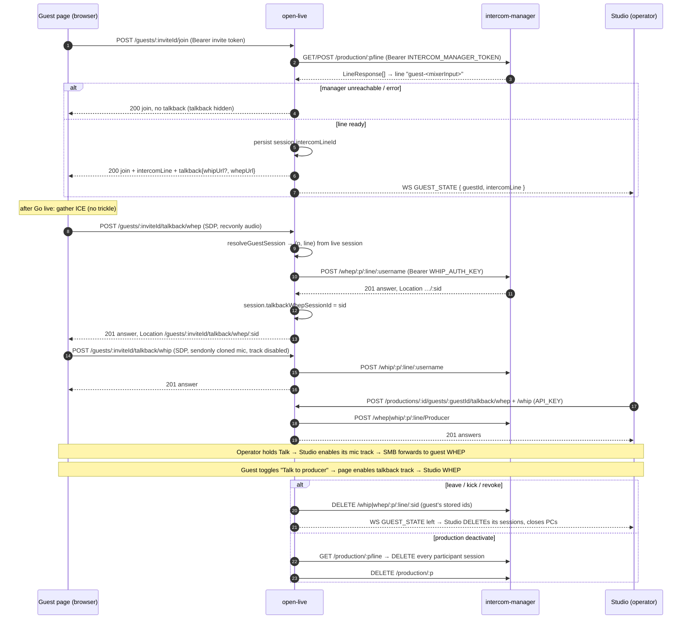

# Spec: Guest talkback — connect the provisioned Intercom line to the guest page and Studio

**Status: Proposed** (architect draft for issue #593)
**Author:** architect agent
**Addendum to:** [`guest-calling-intercom.md`](guest-calling-intercom.md) (Accepted, epic #208),
which covers talkback line *provisioning* only (#302/#304).
**ADR:** [ADR-012](../decisions/ADR-012-guest-talkback-whip-whep-proxy.md) (protocol and proxy choice)
**Related:** Eyevinn/open-live#593, Eyevinn/open-live-site#233 (parent), Eyevinn/intercom-manager
(Open Intercom), open-live-studio PR #152 (operator guest UI, merged)

Sources checked for this spec:

| Repo | Ref |
|------|-----|
| Eyevinn/open-live | `main` @ `67fe32bc` |
| Eyevinn/open-live-studio | `main` @ `8e8d3e5e` |
| Eyevinn/intercom-manager | `main` @ `6a977b8d` (v4.1.0, the OSC `beta` image) |
| eyevinn-osaas/intercom-manager | `3b6fa09b` (v3.5.3, the OSC `stable` image) |
| OSC catalog | `get-service-schema eyevinn-intercom-manager` (2026-10-28) |

## 1. Problem Statement

When intercom is configured, guest join provisions an Open Intercom line and returns
`intercomLine` (`src/routes/guests.ts:669-705`, `:776-778`), and `GUEST_STATE` carries the line id
(`guests.ts:152`). No client joins that line:

- The guest page (`src/routes/guest-page.ts`) never reads `intercomLine`.
- Studio stores the id (`src/store/guests.store.ts`, `src/hooks/useControllerWs.ts`) and only
  renders a "Talkback" hint (`src/pages/ControllerPage/GuestPanel.tsx:271-283`).
  `useIntercomAudio.ts` and `intercom.store.ts` exist but nothing imports `useIntercomAudio`.

The operator cannot talk to a guest, and the guest cannot answer off-air. The open-live-site
`/remote-guests` page lists talkback as "not yet".

### 1.1 Provisioning does not work against a real intercom-manager (found while verifying)

Talkback cannot ship on top of today's provisioning. Verified in source:

1. **Wrong response shape.** `POST /api/v1/production/:productionId/line` returns
   **`LineResponse[]`**, every line of the production (`api_productions.ts:477-520`, response
   `200: Type.Array(LineResponse)`; the same on v3.5.3). `provisionGuestLine`
   (`src/lib/intercom-manager.ts:118-129`) reads `line.id` off an object, finds none, and throws
   `IntercomManagerError('intercom-manager returned no line id')`. So join answers **502** on every
   call once `INTERCOM_MANAGER_URL`/`TOKEN` are set. `src/__tests__/guests-intercom.test.ts:177-179`
   mocks an object `{ id, name, joinUrl }`, a shape the manager does not return.
2. **Rejoin collides.** Line names are unique per production. The manager answers
   `400 { message: 'Line with name … already exists' }`. The line is named
   `invite.label ?? mixerInput` and is provisioned again on every join, so a reconnecting guest
   (same invite) or two invites with the same label get a 502.
3. **`joinUrl` does not exist.** `LineResponse` is `{ name, id, smbConferenceId, participants,
   programOutputLine?, videoEnabled?, whepSourceSessionId? }` (`models.ts:303-311`). No manager
   response has a join URL, so `IntercomLine.joinUrl` is never set.
4. **Join fails hard.** An unreachable manager makes join return 502
   (`guests.ts:684-687`). #593 asks for the opposite: talkback is hidden and join still works.

§3.6 fixes all four as part of this work (sub-issue OL-A).

## 2. Design summary

- **Protocol: WHIP + WHEP per line.** Each talkback participant opens two PeerConnections on
  the guest's line: a **WHIP** publish (send mic) and a **WHEP** subscribe (hear the line). This
  uses intercom-manager's standard per-line endpoints (§3.1), not its browser session API. Reasons
  are in ADR-012.
- **Auth: an open-live proxy.** intercom-manager guards WHIP/WHEP with **one global Bearer
  `WHIP_AUTH_KEY`**. There is no line-scoped credential. So nobody's browser talks to the manager.
  open-live adds a guest-token-authed proxy (guest page) and an `API_KEY`-authed crew proxy
  (Studio). It derives `productionId` and `lineId` server-side and holds the key itself. This is
  the same scoping model as the guest WHIP and return aliases (issue #423).
- **Line: one per guest slot.** The line is named after the slot, reused on rejoin and by the
  slot's next occupant, and removed with the intercom production at deactivate.
- **Operator: embedded in Studio.** GuestPanel gets a per-guest Talk control (§5). No
  intercom-frontend share link.
- **Degradation is first-class.** Intercom unconfigured, manager unreachable, or line missing all
  mean that `talkback` is absent from join, the page and Studio hide the control, and join is
  unaffected.

## 3. API Design

All new routes sit under `/api/v1` with the existing conventions: zod validation, `503` on a DB
failure, `{ error, statusCode }` error bodies.

### 3.1 intercom-manager endpoints used (verified, not invented)

All are mounted under `api/v1` (`src/api.ts:169-206`). `INTERCOM_MANAGER_URL` therefore already
ends in `/api/v1`: the existing client calls `${base}/production` directly
(`intercom-manager.ts:105`).

| Call | Auth | Request | Responses (verified) | Source |
|------|------|---------|----------------------|--------|
| `POST /whip/:productionId/:lineId/:username` | `Bearer WHIP_AUTH_KEY` (none if unset on the manager) | `Content-Type: application/sdp`, body = SDP offer (≤ 64 KiB) | `201` SDP answer, headers `Location: /api/v1/whip/:p/:l/:sessionId`, `ETag: <sessionId>`, `Link: <ICE servers>`; `400` malformed SDP; `401` bad key; `406` an m= section not negotiated; `415` not `application/sdp`; `429` rate limit (10/min); `500` | `api_whip.ts:109-325` |
| `DELETE /whip/:productionId/:lineId/:sessionId` | same | — | `200 'OK'`; `400` sessionId not a UUID; `404 'WHIP session not found'`; `500` | `api_whip.ts:327-440` |
| `PATCH /whip/:productionId/:lineId/:sessionId` | — | — | **`405`, a stub. No trickle ICE.** | `api_whip.ts:442-462` |
| `POST /whep/:productionId/:lineId/:username` | same | as WHIP; offer must be recvonly | as WHIP, `Location: /api/v1/whep/:p/:l/:sessionId` | `api_whep.ts:109-339` |
| `DELETE /whep/:productionId/:lineId/:sessionId` | same | — | `200 'OK'`; `404 'WHEP session not found'`; `500` | `api_whep.ts:341-407` |
| `PATCH /whep/…/:sessionId` | — | — | `405` stub | `api_whep.ts:409-429` |
| `POST /production` | `Bearer API_KEY` (v4.1.0 only; no-op when unset) | `{ name, lines: [] }` | `200 { name, productionId }` | `api_productions.ts:137-189` |
| `POST /production/:productionId/line` | same | `{ name }` | `200 LineResponse[]`; `400 { message }` duplicate name | `api_productions.ts:477-520` |
| `GET /production/:productionId/line` | none (only the global `REQUIRE_AUTH` hook) | — | `200 LineResponse[]` (`participants[]` = `{ name, sessionId, isActive, isWhip, isWhepReceiver?, … }`) | `api_productions.ts:423-475`, `models.ts:253-261` |
| `DELETE /production/:productionId` | `Bearer API_KEY` | — | `200`; **`409` while any session is active (v4.1.0)**; `500` | `api_productions.ts:1215-1257` |

Path constraints the proxy must respect: `productionId` and `lineId` match `^[0-9]+$`, and
`username` matches `^[\w .-]{1,200}$` (`api_whip.ts:119-133`). intercom-manager has no
`trustProxy`, so its 10/min WHIP/WHEP POST limit is counted per peer IP. Every proxied call comes
from open-live's IP, which makes that limit deployment-wide (Risk R3).

WHIP sessions with no media are reaped by the manager: SMB endpoint idle timeout plus
`WHIP_INACTIVE_ALLOW_MS` (10 s), `production_manager.ts:150-240`. A crashed browser therefore
cleans up without our help. Explicit teardown (§6) still runs so the line frees immediately.

### 3.2 Guest talkback routes (guest page; invite token)

These follow the guest WHIP alias pattern (`src/routes/whip.ts:386-460`). The handler verifies
the token through `resolveGuestSession` and reads `mixerInput` and the line from the guest's
**live** session, never from the URL or the invite. The paths sit under `/api/v1/guests` because
the OSC ingress only passes that prefix (osaas-app#6143, `docs/repo-patterns.md`). The
`isGuestTokenAuthedPath` regex in `src/server.ts:106` gains
`talkback/(whip|whep)(?:/[0-9a-fA-F-]{36})?`, kept anchored.

```
POST   /api/v1/guests/:inviteId/talkback/whip           (Authorization: Bearer <invite token>)
POST   /api/v1/guests/:inviteId/talkback/whep
  Content-Type: application/sdp, body = complete SDP offer (ICE gathered; no trickle)
  201 → body: SDP answer; Content-Type: application/sdp
        Location: /api/v1/guests/:inviteId/talkback/{whip|whep}/:sessionId
  400 → { error: 'Malformed SDP' }                      (manager 400)
  401 → { error: 'Invalid or expired invite' }          (bad/revoked/expired token, left/kicked guest)
  403 → { error: 'This guest slot does not take WHIP' } (whip only: return-only slot, §4.3)
  404 → { error: 'Talkback unavailable' }               (intercom off, no intercomLineId, manager 404)
  406 → { error: <manager message> }                    (pass-through)
  415 → { error: 'Unsupported Media Type' }
  429 → { error: 'Too many requests' }                  (open-live's own 10/min/route limit)
  502 → { error: 'Intercom manager unreachable' }       (network error, 5xx, or manager 401 = key mismatch; logged)
  503 → { error: 'Intercom manager busy' } + Retry-After (manager 429)
  503 → { error: 'Guest calling is disabled' }          (existing gate)

DELETE /api/v1/guests/:inviteId/talkback/whip/:sessionId
DELETE /api/v1/guests/:inviteId/talkback/whep/:sessionId
  204                                                   (also when the manager says 404: already gone)
  400 → sessionId not a UUID
  401 → as above
  403 → { error: 'Session does not belong to this guest' }   (≠ stored talkback session id)
```

- **Username sent to the manager:** the invite label with every character outside
  `[\w .-]` replaced by `_`, cut to 200 characters. Fallback `Guest <slot number>`. The
  client never chooses it.
- **Binding:** on a `201` the handler writes the manager `sessionId` (the last segment of the
  manager `Location`, which must equal `ETag`) to the live session as `talkbackWhipSessionId` or
  `talkbackWhepSessionId` (§4). This works like `returnWhepSessionId` (`returns.ts:127,241`).
  A new POST replaces the stored id. The handler then DELETEs the previous manager session
  (best effort), so a rejoin never leaves two of the guest's sessions on the line.
- **Headers not forwarded:** the manager's `Link` header is dropped. It can carry the manager's
  long-lived TURN credentials (intercom-manager `src/server.ts:56` warns about this). The guest page already has ICE
  servers from join (Strom's list, TURN included). `ETag` is replaced by the open-live session id.

### 3.3 Crew talkback routes (Studio; `API_KEY` / crew token)

```
POST   /api/v1/productions/:id/guests/:guestId/talkback/whip[?name=<display name>]
POST   /api/v1/productions/:id/guests/:guestId/talkback/whep[?name=<display name>]
  same request/response/error contract as §3.2, except:
  401 → missing/invalid API_KEY (server.ts default gate; no exemption)
  404 → { error: 'Guest not found' } (no such session, other production, or state 'left')
        { error: 'Talkback unavailable' } (as §3.2)
  Location: /api/v1/productions/:id/guests/:guestId/talkback/{whip|whep}/:sessionId

DELETE /api/v1/productions/:id/guests/:guestId/talkback/{whip|whep}/:sessionId
  204 (manager 200 or 404); 400 non-UUID
```

- `name` is sanitized the same way. Default `Producer`.
- Crew sessions are **not persisted**. Studio owns them. Crew is trusted at production scope,
  like the crew WHIP routes. The server-side sweep (§6) finds them through the line's
  participant list.
- No `PATCH` route exists on either surface. The manager's PATCH is a 405 stub, so both clients
  do non-trickle ICE: gather, then POST. The guest page already does this (`waitForIce`,
  `guest-page.ts:640-655`).

### 3.4 Join response and guest projection

Join adds a server-issued `talkback` object when a line is provisioned. Following the return-feed
rule, URLs come from the server and clients never build them:

```ts
intercomLine?: { id: string; productionId: string; name: string };   // joinUrl removed (never set)
talkback?: {
  whipUrl?: string;   // `${base}/api/v1/guests/:inviteId/talkback/whip`; absent on a return-only slot
  whepUrl: string;    // `${base}/api/v1/guests/:inviteId/talkback/whep`
};
```

`talkback` is present only when join provisioned or reused a line (§3.6). The guest page shows
talkback **only** when `talkback` is present. `GUEST_STATE.intercomLine` (line id) is unchanged
and stays Studio's availability signal. No WebSocket change is needed: Studio builds the
documented crew paths from `productionId` + `guestId`, as it does for every crew route.

### 3.5 Error code additions

These are added to `guest-calling-intercom.md` §"Error codes": `404 Talkback unavailable`,
`502` (manager unreachable or key mismatch, talkback routes only), and `503 + Retry-After`
(manager rate limit). **Join no longer returns 502 for intercom** (§3.6).

### 3.6 Provisioning fixes (prerequisite, changes the Accepted spec's join behaviour)

1. **Read the array.** After `POST …/line`, pick the entry whose `name` equals the requested name
   from the returned `LineResponse[]`.
2. **One line per slot, reused.** The line name is `guest-<mixerInput>` (unique per production,
   stable across occupants). If the line already exists (manager `400` duplicate, or present in
   `GET /production/:p/line`), use that line's `id`. Join on a reconnect or by the slot's next
   occupant then never fails. The operator-facing name stays open-live's invite label.
3. **Degrade instead of 502.** Any `IntercomManagerError` during provisioning is logged at warn
   level. Join then returns `200` without `intercomLine`/`talkback`, and the session has no
   `intercomLineId`. This supersedes `guests.ts:684-687` and the "502/503 … intercom-manager
   unreachable" row for join in the Accepted spec. #593 requires join to work in every intercom
   failure case.
4. **Drop `joinUrl`** from `IntercomLine` and from `docs/openapi.yaml`.
5. **Tests use the real shapes** (`LineResponse[]`, duplicate-name `400`), not invented objects.

## 4. Data Model

```ts
interface GuestSessionDoc {
  // … existing fields …
  intercomLineId?: string;          // existing
  /** intercom-manager WHIP session id of this guest's talkback publish (§3.2). Internal. */
  talkbackWhipSessionId?: string;
  /** intercom-manager WHEP session id of this guest's talkback listen (§3.2). Internal. */
  talkbackWhepSessionId?: string;
}
```

- Both are stripped from `sessionToApi` (`guests.ts:126`), like `whipSessionUrl`.
- `ProductionDoc.intercomProductionId` is unchanged. `IntercomLine.joinUrl` is removed (it was
  never persisted).
- **Migration:** none. The fields are optional and additive, and CouchDB is schemaless. Sessions
  written before this change have no talkback ids, and teardown treats that as "nothing to
  DELETE". Lines created under the old naming (`invite.label`) on a still-active production are
  ignored. They were unusable anyway (§1.1) and are removed with the production at deactivate.
- `docs/openapi.yaml` (join response, new routes) and `docs/controller-websocket.md` (no change)
  are updated in lockstep with the implementation.

### 4.1 Slot rules

| Slot | Guest send (WHIP) | Guest listen (WHEP) | Device prompt |
|------|-------------------|---------------------|---------------|
| WHIP slot | yes, a clone of the page's existing mic track | yes | unchanged (already prompts) |
| Return-only slot (SRT encoder) | **no** (`whipUrl` absent, POST `403`) | yes | **none**. Keeps the return-only "no device prompt" rule |

## 5. Service Interactions



### 5.1 Guest page (open-live, `src/routes/guest-page.ts`)

- **When:** after Go live succeeds (publish connected), and only if join returned `talkback`.
  WHEP first, then WHIP, so the guest hears the producer even if publishing talkback fails.
  Failures here never touch the program publish or the return feed. They only hide the talkback
  UI and show a hint ("Talkback to the producer is unavailable"), like `watchReturnConnection`.
- **WHEP:** a new PeerConnection with one `audio` transceiver, `recvonly`, on the join's ICE
  servers (`newPeerConnection`). The remote track plays through a dedicated
  `<audio autoplay playsinline>` element. Go live is a user gesture, so autoplay is allowed.
- **WHIP:** a separate PeerConnection with one `audio` transceiver, `sendonly`, carrying
  **`localStream`'s audio track `.clone()`**. The clone keeps talkback independent of the program
  mute (#382). A guest muted to air can still answer the producer, and a guest talking to the
  producer is not put on air by it. `switchDevice('audio')` also calls `replaceTrack` on the
  talkback sender with a clone of the new track.
- **Echo cancellation:** talkback audio comes out of the guest's speakers next to the program
  mic. The page's audio constraint becomes `{ echoCancellation: true, deviceId? }`, explicitly
  requested per `docs/repo-patterns.md` ("Echo cancellation must be explicitly requested").
  `noiseSuppression`/`autoGainControl` keep browser defaults so the on-air sound does not change.
  Remote talkback audio is rendered from a WebRTC track, which browser AEC uses as its reference.
  A one-line "Use headphones for the best sound" hint shows while talkback is connected.
- **Guest talk control:** a "Talk to producer" toggle (latch). **Default off**, with the talkback
  track `enabled = false` (silence is sent, so it does not take dominant speaker). Pressed, it
  shows "Producer can hear you" (see OQ1 for the default).
- **Connection loss:** `failed` on either talkback PC → hide the control, show the hint, and
  retry once after 5 s. A `401` stops retrying (guest left or was kicked).
- **Teardown:** in `leave()`/`pagehide`/`teardown()`, DELETE both talkback resources
  (`keepalive: true`) and close the PCs. Server-side teardown (§6) covers a page that never gets
  to do this.

### 5.2 Operator path (open-live-studio, `GuestPanel.tsx`)

**Decision: embedded WebRTC in GuestPanel.** The intercom-frontend share link was rejected for
these reasons:

- It takes the operator out of Studio to a second app. The operator then has to pick the right
  line by name and handle that app's own login: the manager's `REQUIRE_AUTH` role passwords, or
  OSC re-auth.
- A share link needs `POST /share` (API_KEY, plus `OSC_ACCESS_TOKEN`/`publicHost` on the
  manager), which open-live does not configure.
- intercom-frontend has no knowledge of open-live guest state (left/kicked/on-air), so it cannot
  tear down with the guest.
- Talking to one specific guest from where the guest is shown (the slot row) is the
  user need in #593.

Behaviour:

- **Availability:** a guest row shows talkback controls only when `guest.intercomLine` is set.
  The existing "Talkback" chip becomes the control.
- **Open talkback (one click per guest):** acquires the mic through `useIntercomAudio`
  (`INTERCOM_AUDIO_CONSTRAINTS`: echoCancellation/noiseSuppression/autoGainControl on). Then
  connects WHEP (listen) and WHIP (talk, track disabled) through the crew routes with the crew
  `Authorization` header (`src/lib/api.ts` token). Connecting ahead of the first Talk press avoids
  clipping the first words while ICE runs.
- **Talk:** **push-to-talk (hold) by default.** While the button is held, the per-guest clone of
  the mic track is `enabled = true`. A lock toggle next to it latches. Only one guest at a time
  can be latched; latching another releases the first. Releasing, blur/visibility-hidden, or
  pointer-cancel ends a PTT press, so a stuck key cannot leave the operator's room live in a
  guest's ear.
- **Listen:** the line's audio plays while talkback is open. Each guest has a Listen mute and
  listening defaults on.
- **Device selection:** a mic picker in the Guests panel header bound to
  `intercom.store.micDeviceId`/`availableDevices`. Studio already enumerates devices. Output
  device: `HTMLMediaElement.setSinkId` where the browser supports it, otherwise the system default.
- **Teardown:** on `GUEST_STATE` `left`, production inactive, "Close talkback", or panel unmount,
  DELETE both crew sessions and close the PCs. The mic is released when no talkback is open.
- **Media layer:** a new `src/lib/talkback.ts` with plain `RTCPeerConnection` + `fetch`. It is
  modelled on `src/lib/whep.ts` but sends an `Authorization` header, gathers ICE before the POST,
  and uses audio-only transceivers. `connectWhep` (video + 6 audio, no auth) is not reused as-is.

## 6. Teardown

| Trigger | Server (open-live) | Clients |
|---------|--------------------|---------|
| Guest **leave** (`DELETE /guests/:inviteId/session`) | Next to `teardownGuestWhip`: DELETE the manager WHIP/WHEP sessions in `talkbackWhipSessionId`/`talkbackWhepSessionId`. Best effort, outcome logged, never blocks the leave | Page closes its PCs. Studio sees `GUEST_STATE left` and closes its PCs |
| Operator **kick** (`DELETE /productions/:id/guests/:guestId`) | Same | Guest's PCs die with their SMB endpoints, and talkback routes now 401. Studio closes on `left` |
| Invite **revoke** (`DELETE …/invites/:inviteId`) | Same, for each live session of the invite (it is already marked `left` and broadcast) | Same |
| Production **deactivate** | Before `teardownIntercomProduction`: `GET /production/:p/line` for each line, then DELETE `/whep/…/:sid` for every participant with `isWhepReceiver`, and `/whip/…/:sid` for every other participant with `isWhip`. This includes Studio sessions open at deactivate. Then `DELETE /production/:p`. A `409` (a session still active) is logged, and the manager's reaper takes over. Never blocks deactivation | Studio closes on production status inactive |
| Browser crash / network loss | Nothing extra: the manager reaps WHIP sessions with no media (§3.1) | — |

The line itself is **not** deleted on leave. It belongs to the slot and is reused (§3.6).
`DELETE …/line/:lineId` also refuses lines with active participants (`api_productions.ts:913-918`).

## 7. Configuration

| Env var | Required | Default | Purpose |
|---------|----------|---------|---------|
| `INTERCOM_MANAGER_URL` | to enable talkback | — | Existing. Base URL **including `/api/v1`** (documented; it is already required by the existing client) |
| `INTERCOM_MANAGER_TOKEN` | to enable talkback | — | Existing. Management Bearer (the manager's `API_KEY`) |
| `INTERCOM_WHIP_AUTH_KEY` | when the manager sets `WHIP_AUTH_KEY` | — | **New.** Bearer for the manager's WHIP/WHEP endpoints. When unset, the proxy sends no `Authorization` (manager WHIP auth off). A manager `401` is logged as `talkback: intercom-manager rejected INTERCOM_WHIP_AUTH_KEY` and surfaces as 502 |

- **Talkback on/off:** talkback is offered exactly when `isIntercomEnabled()` is true and
  provisioning succeeded. No separate feature flag.
- **Redaction:** add `INTERCOM_WHIP_AUTH_KEY` and the config key `intercomWhipAuthKey` to
  `src/lib/log-redact.ts` and to the Fastify logger redact paths, alongside
  `INTERCOM_MANAGER_TOKEN`. The proxy never logs request `Authorization` headers or the outbound
  headers object.
- **The key never reaches a browser:** it is set only on the outbound request. Neither the
  manager's `Link` header nor its raw `Location` is forwarded.
- **OSC catalog (`eyevinn-intercom-manager`):** config options are `whipAuthKey` (sensitive),
  `iceServers`, `smbUrl`, `smbApiKey`, `dbUrl` and `oscAccessToken`. There is **no `API_KEY`
  option**, so on OSC the management routes rely on whatever OSC gates the instance with (see
  OQ3). README and `.env.example` document the new var.

## 8. Dependencies

Standing rule (CTO, 2026-10-22): no new library without a written reason. **This spec adds no
dependency in any repo.**

| Need | Own code? | Decision |
|------|-----------|----------|
| WHIP/WHEP client (guest page, Studio) | Yes. About 60 lines each: `RTCPeerConnection`, `createOffer`, wait for ICE gathering, `fetch` POST/DELETE. The guest page already does this for program WHIP and the return WHEP. Studio already has `src/lib/whep.ts` | **No library.** A WHIP/WHEP client package would be one function of a larger package and protocol code on our media path |
| SDP handling in the proxy | Not needed. The proxy passes SDP through as an opaque string (≤ 64 KiB, `application/sdp`). Session id comes from the manager's `Location`/`ETag`, checked against a UUID regex | **No `sdp-transform`.** Not parsing untrusted SDP in open-live keeps that work in intercom-manager, which already validates it |
| HTTP to intercom-manager | Node `fetch`, already used by `src/lib/intercom-manager.ts` | No change |
| PTT / device selection (Studio) | Pointer events, `enumerateDevices`, `setSinkId` | No library |

Existing dependencies touched: `src/lib/intercom-manager.ts` imports only `config`. Studio's
talkback code uses React + zustand, which are already present. Nothing to remove.

## 9. Open Questions

Decided by this team (proposed decisions; team-lead confirms at the Phase 1 gate):

1. **OQ1: Default talk mode. The only product call, and it does not block work.**
   Proposed: **operator push-to-talk (hold), with a latch toggle. Guest "Talk to producer" is a
   latched toggle, default off.** Reasoning: producer talkback (IFB) is momentary by broadcast
   convention, and a latched operator mic left open while the guest is on air puts the control
   room in the guest's ear. Guests are non-technical, and holding a button while speaking on
   camera is awkward, so the guest toggles. Defaulting it off means the guest's off-air voice never
   reaches the line unasked. Both modes are built either way. The default is one constant per
   client, so a different PM verdict is a one-line change. **Single question for
   `PM_DECISION_AUTHORITY`:** "Talkback defaults: operator push-to-talk (latch available), guest
   tap-to-talk off by default. OK?"
2. **OQ2: Protocol.** WHIP+WHEP rather than the session API (`POST /session` + `PATCH
   /session/:id`). Decided, see ADR-012.
3. **OQ3: OSC-hosted manager auth.** The catalog has no `API_KEY` option. OSC normally gates a
   service behind a Service Access Token in `Authorization`, which is the same header WHIP auth
   uses. Unverified from source. Proposed: sub-issue OL-A's first step probes the beta instance:
   an unauthenticated `GET {INTERCOM_MANAGER_URL}/productionlist`, then the same call with a SAT.
   If the instance is SAT-gated, add `INTERCOM_MANAGER_AUTH_MODE=osc`. That mode reuses the
   `strom-token.ts` PAT→SAT exchange, generalised to take a `serviceId`
   (`eyevinn-intercom-manager`), and sends the SAT for management and WHIP/WHEP calls. The
   instance's `whipAuthKey` is then left unset, because one header cannot carry both. If it is
   not SAT-gated, `direct` mode as specced. Either way no browser sees any token.
4. **OQ4: Line granularity.** Proposed: **one line per guest slot** (`guest-<mixerInput>`),
   reused (§3.6). Rejected: one shared "guests" line (every guest would hear every other guest's
   off-air talk); one line per guest session (needs line deletion, which the manager refuses
   while anyone is on it, and leaks lines on races).
5. **OQ5: Talk to all guests.** Out of scope for v1. Per-guest only. A "talk to all" is a
   Studio follow-up, possible with multi-line WHIP publishes and no server change.
6. **OQ6: Return-only slots.** Proposed: **listen-only talkback**, keeping the no-device-prompt
   rule (§4.1).
7. **OQ7: Talkback in on-air audio.** Talkback never enters Strom. The guest's talkback is a
   separate cloned track to intercom-manager, and the operator's mic goes only to
   intercom-manager. The only coupling is acoustic (Risk R1).
8. **OQ8: Rate limit.** Proposed: map a manager `429` to `503 + Retry-After`. Clients retry once
   after `Retry-After` (default 5 s). Open an intercom-manager issue (trusted-key bypass or a
   higher authenticated limit) only if the agent-run beta verification hits it. It is not filed
   upfront.

## 10. Risks

- **R1: Acoustic echo onto program.** Producer audio from the guest's speakers can be picked up
  by the program mic if AEC fails (Bluetooth speakers, some Safari builds). Mitigations: explicit
  `echoCancellation: true`, the headphones hint, and push-to-talk on the operator side so the
  producer is only heard when they mean it. Detect it on beta by playing a tone into the line from
  Studio and checking it is absent from program audio.
- **R2: Provisioning was never exercised against a real manager** (§1.1). The fixed tests must
  use real `LineResponse[]` shapes, and the beta verification must run against a real
  intercom-manager instance, not a mock.
- **R3: Shared rate limit.** intercom-manager counts its 10/min WHIP and WHEP POST limits per
  peer IP with no `trustProxy`, so all of a deployment's guests and operators share them.
  Example: 5 guests + 2 operators reconnecting at once is 7 POSTs per route. Handled by OQ8.
  Watch for `talkback … 429` warnings in the logs.
- **R4: SSRF / key exfiltration.** The proxy builds manager URLs only from config +
  numeric-validated ids it read from its own DB. It refuses ids not matching `^[0-9]+$` and
  session ids not matching a UUID, and forwards nothing client-supplied except the SDP body.
  It follows the `assertSameStromOrigin` discipline: a manager `Location` that is not
  `/api/v1/{whip|whep}/<p>/<l>/<uuid>` on the manager origin is rejected with 502.
- **R5: Cross-guest access.** A guest could try another guest's session id. DELETE checks the
  stored id (403). POST takes the line only from the caller's live session, and a left/kicked
  guest is 401 (`resolveGuestSession`).
- **R6: Dominant-speaker forwarding.** The manager uses `ssrc-rewrite` audio
  (`api_whep.ts`, `createEndpoint(..., 'ssrc-rewrite')`) and the WHEP answer declares no audio
  SSRC, so one recvonly m-line receives the forwarded speaker(s). With several operators talking
  at once to one guest, the guest may hear only the loudest. That is acceptable for 1:1 talkback.
  Beta verification checks two-way audio with one operator.
- **R7: Version skew.** OSC `stable` is v3.5.3 and `beta` is v4.1.0. Everything in §3.1 used by
  the proxy exists in both (checked at `3b6fa09b`). v3.5.3 has no `API_KEY` guard and no `409` on
  production delete. Nothing here relies on v4-only routes. The force-disconnect route is v4-only
  and deliberately not used.
- **R8: Operator never opens talkback.** Then nothing changes for the guest. Their listen PC is
  connected and silent. Cost: one idle SMB endpoint per guest, reaped at deactivate.

## 11. Implementation sub-issues (filed after this spec merges)

Each is machine-completable: done means ready for a human to try. The PR body and closing comment
carry `What a human does next`. Beta verification is agent-run. The runner needs **OSC write
access** to create or reuse an `eyevinn-intercom-manager` instance (beta image) and to set
`INTERCOM_MANAGER_URL`/`INTERCOM_MANAGER_TOKEN`/`INTERCOM_WHIP_AUTH_KEY` on the `openlivedev`
open-live instance (`devops-engineer`). If the runner lacks that capability, the ticket names it
rather than handing it to a person.

**OL-A (Eyevinn/open-live): Fix intercom line provisioning against the real intercom-manager API and degrade instead of failing join**
- `provisionGuestLine` reads `LineResponse[]`, names lines `guest-<mixerInput>`, and reuses an
  existing line on duplicate or rejoin.
- Join returns `200` without `intercomLine` on any `IntercomManagerError` (warn log). `joinUrl`
  is removed from the type and OpenAPI.
- Tests use the manager's real response shapes (array, duplicate `400`, `500`, network error)
  and cover rejoin with the same invite and two invites with the same label.
- OQ3 probe run against the beta manager. If it is SAT-gated, `INTERCOM_MANAGER_AUTH_MODE=osc`
  is implemented with the generalised token exchange.
- Agent-run on `openlivedev` with a real manager: join twice with the same invite → both `200`
  with the same `intercomLine.id`. Stop the manager → join `200` without `intercomLine`.

**OL-B (Eyevinn/open-live): Guest and crew talkback WHIP/WHEP proxy routes** (blocked by OL-A)
- §3.2/§3.3 routes with the exact status codes above. `isGuestTokenAuthedPath` is extended and
  anchored. The join response gains `talkback`. `GuestSessionDoc` gains the two internal ids.
- `INTERCOM_WHIP_AUTH_KEY` config, redaction in `log-redact.ts` + logger redact paths, README,
  `.env.example`, `docs/openapi.yaml`.
- Tests: token/kicked/revoked → 401; other guest's session id → 403; return-only WHIP → 403;
  intercom off → 404; manager 401/5xx/network → 502; manager 429 → 503 + Retry-After; `Link`
  not forwarded; malformed manager `Location` → 502; the key never appears in a response or log
  line (log capture test).
- Agent-run on `openlivedev`: a scripted headless-browser WHEP + WHIP through both surfaces
  gets `201`, and the manager's `GET /production/:p/line` lists the sessions. DELETE → 204, and
  the participant is gone.

**OL-C (Eyevinn/open-live): Tear down talkback sessions on leave, kick, revoke and deactivate** (blocked by OL-B)
- §6 table implemented. Best effort, logged, never blocks the triggering action. The deactivate
  sweep runs before `teardownIntercomProduction`.
- Tests for each trigger, including manager unreachable (the action still succeeds).
- Agent-run on `openlivedev`: open guest + crew talkback, then kick → guest sessions gone from the
  line within 2 s. Deactivate → intercom production deleted (manager `GET /production/:p` → 404).

**OL-D (Eyevinn/open-live): Guest page talkback client** (blocked by OL-B)
- §5.1: WHEP auto-listen after Go live, cloned-mic WHIP, "Talk to producer" toggle (default per
  OQ1), explicit `echoCancellation: true`, headphones hint, device switch updates the talkback
  sender, listen-only on return-only slots, teardown on leave/pagehide. Hidden when `talkback`
  is absent. Talkback failure never affects publish or return.
- Agent-run on `openlivedev` with headless Chromium (fake media): join a WHIP slot → two talkback
  PCs `connected`. The toggle flips the sender track `enabled`. Join with intercom unset → no
  talkback element in the DOM and Go live still works.

**OLS-A (Eyevinn/open-live-studio): Operator talkback in GuestPanel** (blocked by OL-B)
- §5.2: `src/lib/talkback.ts` (fetch + RTCPeerConnection, auth header, non-trickle,
  audio-only). Per-guest Open talkback / Talk (PTT, latch toggle per OQ1, single latch) / Listen
  mute. Mic picker wired to `useIntercomAudio` + `intercom.store`. Output device via `setSinkId`
  where supported. Teardown on `GUEST_STATE left`, production inactive, close, unmount. Controls
  hidden without `guest.intercomLine`.
- Unit tests for the PTT state machine (press/release/blur/visibility/latch exclusivity) and for
  teardown on `left`.
- Agent-run against `openlivedev`: open talkback for a guest started by the OL-D headless guest →
  both sides' `RTCPeerConnection` `connected`. A Studio tone with Talk held is detected on the
  guest's received track (`getStats` audio level > 0). Released → level ~0.

Dependency order: OL-A → OL-B → (OL-C ∥ OL-D ∥ OLS-A).

What a human does next (after all close): Set `INTERCOM_MANAGER_URL` (with `/api/v1`),
`INTERCOM_MANAGER_TOKEN` and `INTERCOM_WHIP_AUTH_KEY` (equal to the manager's `WHIP_AUTH_KEY`)
on a production instance. Join as a guest, open talkback in Studio, hold Talk, and expect the
guest to hear the producer while the guest's own on-air audio is unaffected.
