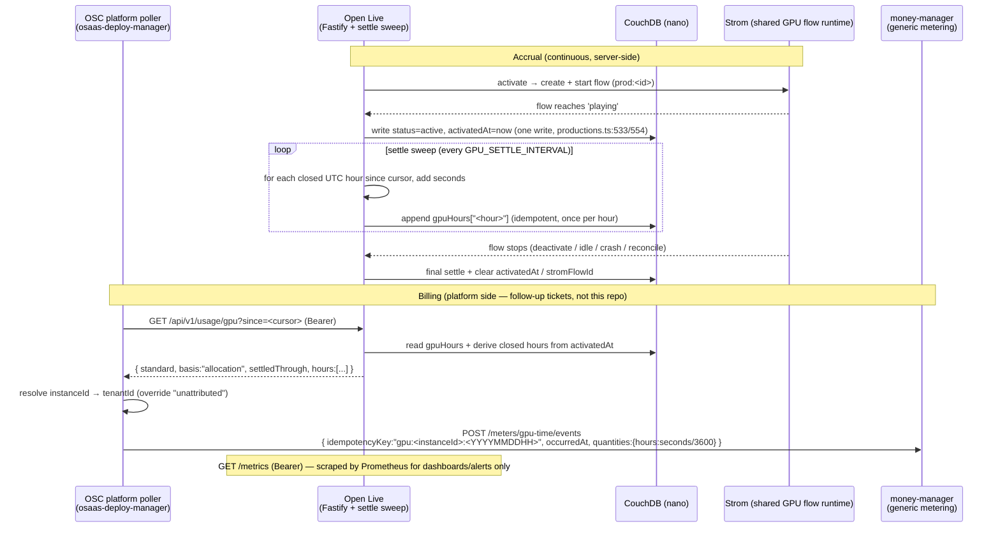

# Spec: Shared-GPU usage metering for Prometheus + OSC token billing

**Status: Proposed** (architect draft for issue #500)
**Author:** architect agent
**Related issues:** #500 (this feature). Reuses the OSC generic-metering pattern established for
CDN acceleration ([agent-team-osc-dev ADR-0057](https://github.com/Eyevinn/agent-team-osc-dev/blob/main/adr/0057-per-endpoint-cdn-acceleration-metered-to-tokens.md):
per-hour events → money-manager `POST /meters/:meterId/events`).
**Related ADR:** `docs/decisions/ADR-005-shared-gpu-usage-metering-allocation-basis.md`.

> Proposed spec, not an accepted decision. Phase-1 deliverable per `epic-workflow.md` §Phase 1.
> No implementation starts until the team-lead gate passes and the human-level Open Questions
> (OQ-1, OQ-2 below) are resolved. The two product/billing-policy calls are **not** pre-decided
> here; the engineering-level calls (allocation basis for v1, reuse of the CDN metering pattern)
> are decided in ADR-005 and summarised in §Decision.

## 1. Problem Statement

Open Live runs each production as a GStreamer pipeline (a Strom *flow*) on a GPU-backed Strom. The
managed offering bills a flat "69 EUR/month (shared GPU in Frankfurt)" (`README.md:14`) regardless
of how much GPU time a tenant actually consumes. There is **no surface anywhere in open-live that
reports GPU time consumed** — no `/metrics` endpoint (confirmed: `src/routes/health.ts` exposes only
`/health`, `/healthz`, `/ready`; there is no `prom-client` dependency in `package.json`), and no
usage JSON endpoint.

Two consumers need this data:

1. **Prometheus / Grafana** — operational dashboards and alerting on GPU load across instances.
2. **The OSC platform** — to convert consumed GPU time into token consumption, exactly as CDN
   acceleration is metered today (per-hour idempotent events to money-manager's generic metering
   engine). A flat monthly price does not scale with use; metering lets the platform charge for
   hours/minutes consumed, and lets any future GPU-consuming OSC service (transcoding, AI inference,
   graphics rendering) reuse one contract instead of inventing a bespoke endpoint each.

This spec defines the two open-live surfaces, the data model that makes them survive restart, and
proposes the cross-service **`osc-gpu-usage/v1`** standard so the platform integrates once.

### Goals

- `GET /api/v1/usage/gpu` — closed UTC-hour buckets of shared-GPU seconds per production, bearer-authed.
- `GET /metrics` — Prometheus text format with `osc_gpu_seconds_total` + `osc_gpu_active`, bearer-authed.
- Accrual that survives an open-live restart and settles the final partial hour on abnormal pipeline end.
- A written `osc-gpu-usage/v1` standard other OSC services can implement without reading this code.

### Non-goals (out of scope, follow-up tickets)

- money-manager meter registration, rate card, the platform poller and token conversion (platform
  side — separate tickets in `osaas-money-manager` / `osaas-deploy-manager`).
- Utilisation-based metering (NVENC/NVDEC/SM load via NVML/DCGM). v1 is allocation-based (§Decision).
- Changing the price of the shared-GPU plan (a product decision, OQ-2).
- Any Studio UI. This is a backend/platform contract only.

## 2. API Design

Two new routes. **No existing route changes shape or behaviour.** Both require a bearer token.

### 2.1 Auth model — grounded in the real gate, and a trap to avoid

Open Live's shared-key auth is an `onRequest` hook installed **only when `config.apiKey` is set**
(`src/server.ts:374-455`). Two properties of that hook are load-bearing here:

1. `AUTH_EXEMPT_PATHS = new Set(['/health', '/ready', '/api/v1/status'])` (`src/server.ts:67`) is the
   explicit allow-anonymous list. **Neither new route may be added to it**, nor to `DB_EXEMPT_PATHS`
   (`src/server.ts:61`) unless the route genuinely must answer without CouchDB (see §3.4).
2. **The hook only guards paths that start with `/api/v1`, `/ws/`, or `/documentation`** — every
   other path hits the `return;` at `src/server.ts:400-406` and is served **without auth**, exempt
   list or not.

Consequences, stated precisely so implementation does not ship an open metrics endpoint:

| Route | Under a guarded prefix? | What is required |
|---|---|---|
| `GET /api/v1/usage/gpu` | Yes (`/api/v1`) | Guarded by the shared key automatically. Just keep it **out** of `AUTH_EXEMPT_PATHS`. |
| `GET /metrics` | **No** — top-level path | The exempt list is **necessary but not sufficient**. `/metrics` must ALSO be added to the guarded-prefix check at `src/server.ts:400-406` (e.g. `|| req.url.startsWith('/metrics')`), OR the route must be mounted at `/api/v1/metrics`. Without one of these, `/metrics` falls through the `return;` and is anonymous. |

**Recommendation:** add `/metrics` as a top-level path (the Prometheus convention) **and** extend the
guarded-prefix check to include it, rather than mounting under `/api/v1`, so scrapers use the
conventional path. Acceptance criterion in the issue — "`/metrics` … is not in the auth-exempt list"
— is met, but the spec additionally requires the guarded-prefix extension; a test must assert
`GET /metrics` with no token returns **401** (see §Risks, the "non-sufficient exempt list" trap).

Auth transport reuses the existing bearer rules verbatim (`src/server.ts:362-373,408-420`): REST
clients send `Authorization: Bearer <API_KEY>`; the key is compared with `timingSafeEqual`. Both
routes are GET-only and read-only; neither mutates state, so no audit-log concern beyond the existing
`onResponse` hook (which only logs mutating calls, `src/server.ts:457`).

When `config.apiKey` is unset (self-hosted dev, or `TRUST_EXTERNAL_AUTH`), the hook is not installed
and both routes answer unauthenticated — identical to every other route today; that is an existing,
documented deployment posture, not a regression introduced here.

### 2.2 `GET /api/v1/usage/gpu`

Returns **closed UTC-hour buckets** of shared-GPU time per production, so the platform can poll
idempotently without depending on a monotonic counter surviving across restarts.

**Request**

```
GET /api/v1/usage/gpu[?since=<ISO-8601 hour>]
Authorization: Bearer <API_KEY>
```

- `since` (optional): return only buckets whose `hour` is **strictly after** this ISO hour
  (a cursor). Malformed value → `400`. Absent → return all retained buckets (bounded by retention, §3.5).

**Response — `200 application/json`, schema `osc-gpu-usage/v1`:**

```json
{
  "standard": "osc-gpu-usage/v1",
  "service": "eyevinn-open-live",
  "basis": "allocation",
  "generatedAt": "2026-10-13T14:07:12Z",
  "settledThrough": "2026-10-13T14:00:00Z",
  "hours": [
    {
      "hour": "2026-10-13T13:00:00Z",
      "tenantId": "unattributed",
      "resource": "production-17",
      "gpuPool": "fra-1",
      "gpuClass": "shared",
      "seconds": 3180
    }
  ]
}
```

Field contract:

| Field | Type | Meaning |
|---|---|---|
| `standard` | string const | `"osc-gpu-usage/v1"`. |
| `service` | string | Reporting service id. Value of `config.oscSatServiceId` (`OSC_SAT_SERVICE_ID`, default `eyevinn-open-live`, `src/config.ts:174`). |
| `basis` | `"allocation"` \| `"utilisation"` | v1 is always `"allocation"` (§Decision, ADR-005). The field exists so a future utilisation basis is self-describing, not a breaking change. |
| `generatedAt` | ISO 8601 UTC | When the response was produced. The ONLY non-immutable timestamp. |
| `settledThrough` | ISO 8601 UTC, top of hour | Buckets with `hour < settledThrough` are **immutable**. Always the start of the current UTC hour (the current partial hour is never emitted as a closed bucket). |
| `hours[]` | array | One entry per (closed hour × resource). Empty array is valid (nothing ran). |
| `hours[].hour` | ISO 8601 UTC, top of hour | Bucket start. `hour + 1h <= settledThrough`. |
| `hours[].tenantId` | string | OSC workspace id if resolvable, else `"unattributed"` (§3.6). Never dropped. |
| `hours[].resource` | string | `"production-<ProductionDoc._id>"` — stable per production. |
| `hours[].gpuPool` | string | From `GPU_POOL` config (§5). |
| `hours[].gpuClass` | `"shared"` \| other | From `GPU_CLASS` config (§5), default `"shared"`. |
| `hours[].seconds` | integer ≥ 0 | GPU-seconds accrued in that hour for that resource. `0 <= seconds <= 3600` per (hour × resource). |

**Errors:** `400` (malformed `since`), `401` (missing/invalid bearer), `503` (CouchDB unreachable and
no in-memory buckets available — mirrors how recording degrades, `src/config.ts:269`). No `404`.

**Self-hosted / BYO Strom:** when metering is not enabled (no `GPU_POOL`, or `STROM_AUTH_MODE=direct`
self-hosted — §5), the endpoint returns `200` with `hours: []` and `basis: "allocation"`. It never
reports non-zero shared-GPU time for an instance that is not on the managed shared GPU (issue AC:
"Productions on a self-hosted or BYO Strom report zero shared-GPU time").

### 2.3 `GET /metrics`

Prometheus text exposition. Two series only (the standard's required surface, §6):

```
# HELP osc_gpu_seconds_total Shared GPU time consumed, in seconds.
# TYPE osc_gpu_seconds_total counter
osc_gpu_seconds_total{tenant="unattributed",resource="production-17",gpu_pool="fra-1",gpu_class="shared"} 5421
# HELP osc_gpu_active Number of GPU-consuming workloads running right now.
# TYPE osc_gpu_active gauge
osc_gpu_active{tenant="unattributed",gpu_pool="fra-1"} 1
```

- `osc_gpu_seconds_total` is a **monotonic counter** of cumulative GPU-seconds since process start,
  seeded on startup from persisted accrual (§3.3) so a scrape after restart does not reset to 0
  mid-hour from the operator's perspective (it may still drop on a cold counter reset — Prometheus
  `rate()` handles counter resets; this is exactly why **billing reads the JSON buckets, not this
  counter**, §6).
- `osc_gpu_active` is a **gauge**: count of productions currently `status: 'active'` with a live
  Strom flow, labelled by pool. `0` when nothing runs.
- Label `tenant` carries the same value as JSON `tenantId` (`"unattributed"` when unresolved).
- Content-Type `text/plain; version=0.0.4`. Empty metric families (no active productions, no accrual)
  still emit the HELP/TYPE header lines with no samples — valid Prometheus.

**Implementation note (not a contract):** hand-rendering two families is trivial and avoids a new
runtime dependency; adding `prom-client` is acceptable but is a dependency decision (there is none
today). Either way the two series names/labels above are the contract.

## 3. Data Model

GPU-seconds must be **accrued from real pipeline lifecycle** and **persisted** so neither a restart
nor an abnormal pipeline end loses time. CouchDB via `nano` is the only store (same as everything else).

### 3.1 What accrues (the allocation basis, v1)

Per ADR-005: **wall-clock seconds during which a production's Strom flow holds a slot on the shared
GPU.** For open-live that is the interval `[flow reached 'playing', flow stopped]`. This needs only
data open-live already has; it does not need NVML or any new Strom API.

**The gap this spec must close:** `ProductionDoc` has **no activation timestamp today**. It carries
`createdAt`, `updatedAt`, `airTime` (`src/db/types.ts`), and `stromFlowId` (set when the flow is
created, `src/routes/productions.ts:390`), but nothing records *when the flow reached `playing`*.
Status is written `active` at `src/routes/productions.ts:533,554` with no timestamp. So resume-from-start
(issue AC) is impossible against the current doc shape. This spec adds the field below.

### 3.2 New persisted fields on `ProductionDoc`

Additive, optional, defaulted-absent (no migration; existing docs read as "never accrued"):

```ts
/** ISO 8601 UTC — when this production's Strom flow reached 'playing' (GPU accrual start).
 *  Set in the SAME write that sets status 'active' (productions.ts:533/554); cleared on every stop. */
activatedAt?: string;

/** Closed, settled GPU-second buckets for this production, keyed by UTC hour "YYYY-MM-DDTHH:00:00Z".
 *  Append-only; a key is written once its hour has fully elapsed and is never rewritten. */
gpuHours?: Record<string, number>;
```

- `activatedAt` is the **recorded start** the issue's AC refers to. It is set atomically with
  `status: 'active'` (reusing the existing doc write at `productions.ts:533/554`, not a second write)
  and cleared on every stop path (deactivate `productions.ts:189`, activation-failure reset
  `productions.ts:599`, reconcile reset `services/reconcile.ts:86-92`).
- `gpuHours` holds **only closed hours** (immutable once written). The **current partial hour is
  never persisted here**; it is derived live from `activatedAt` (see §3.4), so the only writer of a
  given key is the settle step for that hour, written exactly once — no read-modify-write races on
  a live-updating counter.

### 3.3 Accrual engine (a settle sweep, not a per-second tick)

A periodic **settle sweep** (reusing the idle-watchdog's interval pattern,
`src/services/idle-watchdog.ts`) runs once per few minutes and, for each production that is `active`
(or was active and just stopped):

1. Compute elapsed seconds per UTC hour between the last-settled boundary and `min(now, stoppedAt)`.
2. For each **fully-elapsed** hour, add the seconds into `gpuHours["<hour>"]` (clamped `0..3600`)
   in a single doc write, and advance the per-doc settle cursor. Already-present keys are skipped
   (idempotent — a key is written once).
3. The current partial hour is left unsettled; it only becomes a `gpuHours` entry after it closes.

This makes the heavy invariant cheap: the only persisted writes are **once per closed hour per
production**, and they are append-only, so concurrent sweeps/restarts cannot double-count (writing
an already-present key is a no-op). It mirrors the CDN metering model (settle hourly, emit immutable
closed buckets) rather than a high-frequency counter.

### 3.4 Surviving restart; resume-from-recorded-start

- On startup, `reconcileProductionStatuses` (`src/services/reconcile.ts`) already cross-references
  each doc's `stromFlowId` (and the `prod:<id>` flow description tag, `reconcile.ts:48-53`) against
  the live Strom flow list. A production whose flow is **still live** is restored to `active`
  (`reconcile.ts:70-76`) **without clearing `activatedAt`** (this spec's one change to reconcile: do
  not touch `activatedAt` on the restore branch). The next settle sweep then accrues the hours that
  elapsed across the downtime from the preserved `activatedAt` — i.e. it **resumes from the recorded
  start, not from zero** (issue AC).
- A production whose flow is **gone** is moved to `ended`/`inactive` by reconcile
  (`reconcile.ts:77-97`). Before clearing `activatedAt`, the settle step runs one final time for it
  so the partial hour up to the last-known boundary is captured (see §3.5). `activatedAt` is then
  cleared with the status write.
- The JSON endpoint reads `gpuHours` (closed hours) + derives the already-elapsed closed hours of the
  current life from `activatedAt`; it never needs CouchDB for the *current partial* hour. This is why
  `/api/v1/usage/gpu` should **not** be in `DB_EXEMPT_PATHS` — it needs CouchDB for persisted buckets.

### 3.5 Abnormal pipeline end (the "do not lose the final partial hour" AC)

Every existing flow-teardown path already converges on a status write that clears `stromFlowId`.
Those are the exact hook points to run a final settle:

| Teardown path | Site | Final-settle obligation |
|---|---|---|
| Explicit deactivate | `src/routes/productions.ts:184-189` | Settle up to `now`, write closed hours, clear `activatedAt`. |
| Idle auto-deactivate | `src/services/idle-watchdog.ts:209` (`deactivateProduction`) | Same. |
| Activation failure / abort | `src/routes/productions.ts:591-600` | Settle up to `now` (flow may have been briefly playing), clear. |
| Startup reconcile, flow gone (crash/kick/delete) | `src/services/reconcile.ts:77-97` | Settle up to the last sweep boundary (the exact death time is unobservable — see §7), clear. |

Because the current partial hour is derived from `activatedAt` and only closed hours are persisted,
a crash **between** sweeps loses at most the seconds of the *in-progress* hour that had not yet
closed — bounded and, on the allocation basis, acceptable (documented in §7, OQ-1). The settle sweep
interval is the tuning knob (§5).

### 3.6 Tenant attribution — the honest finding

`tenantId` is the OSC workspace id. **Open Live does not know it per-production, or at all, today.**
Grepping config: there is `OSC_SAT_SERVICE_ID` (the *service* id, not a tenant/instance id,
`src/config.ts:174`) and `OSC_PAT`/`OSC_ACCESS_TOKEN` (`src/config.ts:157`), but **no instance id,
workspace id, or tenant field** anywhere in `src/config.ts` or `.env.example`. A managed open-live
instance *is* one tenant's instance, but the mapping instance→tenant lives at the OSC platform edge,
not inside open-live.

Design, consistent with the standard's "never dropped" rule:

- Emit `tenantId` from an **optional** `OSC_WORKSPACE_ID` env (§5) **if the platform injects one**.
- When unset (the expected case today), emit `tenantId: "unattributed"`. The bucket is still produced
  and still carries `resource`/`seconds`; the **platform poller resolves instance→tenant** (it knows
  which instance it is polling) and overrides `unattributed`. This matches the standard
  (§6: "a bucket without a resolvable tenant is reported under `unattributed`, never dropped") and
  the issue's unverified risk ("whether `tenantId` is available inside open-live … or only at the
  platform edge") — the answer, from the code, is **only at the platform edge today**.

## 4. Service Interactions



## 5. Configuration

New env vars (all optional; metering is **off** unless `GPU_POOL` is set, so self-hosted/BYO
deployments are unchanged):

| Env var | Default | Meaning |
|---|---|---|
| `GPU_POOL` | *(unset)* | Pool label (e.g. `fra-1`). **Metering is enabled iff this is set.** Unset → `/api/v1/usage/gpu` returns `hours: []`, `/metrics` emits no `osc_gpu_*` samples. |
| `GPU_CLASS` | `shared` | `gpu_class` label value. Only the shared class is metered to tokens; a `dedicated` value can be emitted for dashboards without implying billing. |
| `GPU_SETTLE_INTERVAL_MS` | `300000` (5 min) | Settle-sweep cadence. Lower bounds the worst-case lost partial-hour on crash (§3.5); higher reduces writes. |
| `GPU_USAGE_RETENTION_HOURS` | `2160` (90 days) | How long closed `gpuHours` buckets are retained/returned. Old buckets are pruned on settle. Must exceed the platform's re-poll + 7-day dead-letter window (§6). |
| `OSC_WORKSPACE_ID` | *(unset)* | If the platform injects the workspace id, it is emitted as `tenantId`. Unset → `"unattributed"` (§3.6). |

**No Strom config change.** Accrual reads only the existing flow lifecycle open-live already observes
(`stromFlowId`, the `prod:<id>` description tag, reconcile's `flows.list()`). The spec deliberately
does **not** depend on a new Strom per-pipeline usage API (see §7 — whether Strom can report that is
unverified; the allocation basis is chosen precisely to avoid needing it).

**Shared vs self-hosted detection:** the managed shared-GPU deployment runs `STROM_AUTH_MODE=osc`
against an OSC-hosted Strom (`src/config.ts:130`, README 69 EUR shared-GPU plan); self-hosted runs
`direct` (15 EUR self-hosted Strom). `GPU_POOL` being set is the explicit opt-in that gates all
metering, so the platform (which provisions the managed instance) sets `GPU_POOL`+`GPU_CLASS=shared`
on managed instances and leaves them unset everywhere else. There is **no existing field that marks
an instance as "on the shared GPU"**, which is why this explicit opt-in is introduced rather than
inferred.

## 6. The `osc-gpu-usage/v1` standard (cross-service surface)

Proposed as part of this spec so any OSC service that consumes shared GPU exposes the **same** two
surfaces and the platform integrates once. This section is the normative contract other services
implement; open-live is its first implementor.

| Item | Contract |
|---|---|
| Prometheus counter | `osc_gpu_seconds_total{tenant, resource, gpu_pool, gpu_class}` — monotonic, seconds. |
| Prometheus gauge | `osc_gpu_active{tenant, gpu_pool}` — workloads running now. |
| JSON usage endpoint | `GET /api/v1/usage/gpu`, schema `osc-gpu-usage/v1` (§2.2), `?since=` cursor. |
| Auth | Bearer token, **never anonymous**. (§2.1 — note the open-live `/metrics`-prefix trap.) |
| Basis | Stated in the response: `allocation` (v1) or `utilisation` (later). |
| Granularity | Closed UTC-hour buckets, immutable once `settledThrough` passes them. |
| Attribution | `tenantId` = OSC workspace id; a bucket without a resolvable tenant is `"unattributed"`, **never dropped**. |
| Billing source | The **JSON hour buckets**, not the Prometheus counter. Prometheus is for dashboards/alerting only — a counter loses information on restart and `rate()` windows are approximate. |

**Platform side (separate tickets, NOT this repo), described so the contract is complete:**
register a `gpu-time` meter in the generic metering engine (`unitLabel: "hour"`, dimensioned by
`gpuClass`) with a rate card in tokens/GPU-hour; a poller reads each opted-in instance's
`/api/v1/usage/gpu`, resolves instance→tenant, and posts
`{ tenantId, idempotencyKey: "gpu:<instanceId>:<YYYYMMDDHH>", occurredAt: <hour start>, dimensions: { gpuClass }, quantities: { hours: seconds/3600 } }`
to `POST /meters/gpu-time/events`. The idempotency key makes re-polling safe; the engine's 7-day
`occurredAt` limit means a dead-letter path for hours unreported after ~6 days — identical to CDN.
(These endpoint/field names are the CDN precedent from the issue / ADR-0057, not invented here, and
belong to the platform repos.)

## 7. Open Questions

### Resolved in this spec / ADR-005 (engineering-level, team can decide)

- **Allocation basis for v1.** GPU time = wall-clock seconds a production's flow holds a shared-GPU
  slot (`[playing, stopped]`). Allocation, not utilisation. Decided — §Decision, ADR-005.
- **Reuse the CDN metering pattern** (closed hourly buckets + idempotent per-hour events) rather than
  building a second billing path. Decided — §Decision, ADR-005.
- **Billing reads JSON buckets, not the Prometheus counter.** Decided — §6.
- **Attribution today is platform-edge only** (`tenantId: "unattributed"` from open-live, resolved by
  the poller). Decided from the code — §3.6.

### OQ-1 — settle-sweep interval vs. lost-partial-hour on crash (engineering, team-lead)

On a hard crash between sweeps, up to the in-progress (not-yet-closed) hour's un-swept seconds are
lost (§3.5). `GPU_SETTLE_INTERVAL_MS` bounds this. Is 5 min acceptable, or should the sweep also run
opportunistically on every status write? Recommendation: 5 min + a settle on each stop path (already
specified in §3.5); flag only if the team wants a tighter guarantee for the reconcile-after-crash
case, where the exact death time is genuinely unobservable from open-live.

### OQ-2 — billing policy (PRODUCT-LEVEL — needs a human, @birme/@svensson00)

**Not an engineering decision; explicitly deferred.** (a) **allocation vs. utilisation billing** —
v1 meters *allocated* GPU time (slot held), which is easy to explain on an invoice but charges for an
idle-but-running pipeline; a fairer utilisation basis is harder to meter and dispute. (b) **the rate
card** (tokens per GPU-hour) and whether the flat 69 EUR shared-GPU plan is replaced, supplemented, or
kept with metering only for reporting. (c) whether `gpuClass` dimensions carry different rates. These
are product/commercial calls and must be answered before the platform-side meter is registered; they
do **not** block the open-live surfaces in this spec (which are basis-agnostic via the `basis` field).

## 8. Decision (summary; full rationale in ADR-005)

1. **Allocation basis for v1.** GPU-seconds = wall-clock `[flow playing, flow stopped]` on the shared
   GPU, derived from the lifecycle open-live already observes (no NVML, no new Strom API). The `basis`
   field makes a later utilisation basis non-breaking.
2. **Reuse the CDN metering pattern.** Closed, immutable UTC-hour buckets exposed over a bearer-authed
   JSON endpoint; the platform converts to idempotent per-hour meter events. No second billing path.
3. **Prometheus is observability, not billing.** `/metrics` serves dashboards/alerts; the JSON
   buckets are the billing source of truth.
4. **Accrual is persisted as append-only closed-hour buckets + an `activatedAt` start stamp**, so a
   restart resumes from the recorded start and the final partial hour is settled on every teardown
   path. (Requires the one additive reconcile change: preserve `activatedAt` on the restore branch.)

## 9. Risks

- **The non-sufficient exempt list (critical, code-verified).** Keeping `/metrics` out of
  `AUTH_EXEMPT_PATHS` does **not** authenticate it — the shared-key hook only guards `/api/v1`,
  `/ws/`, `/documentation` prefixes (`src/server.ts:400-406`); a top-level `/metrics` is otherwise
  anonymous. Mitigation: extend the guarded-prefix check (§2.1) and ship a test asserting
  `GET /metrics` → 401 without a token. Without this, implementing the issue's AC literally would
  still expose metrics unauthenticated.
- **`toApi()`-style over-spread leaks (repo-patterns.md §1).** The new `ProductionDoc` fields
  (`activatedAt`, `gpuHours`) must not leak through any `{ ...rest }` response spread on the
  productions routes in a way that bloats or confuses existing clients. They are internal accrual
  state; project them only via `/api/v1/usage/gpu`, not via the production GET/list responses.
- **Strom pipeline-lifecycle observability (issue unverified risk).** The allocation basis depends
  only on what open-live already tracks (`activatedAt` set at `playing`, `stromFlowId`, the
  `prod:<id>` tag, reconcile's `flows.list()`) — deliberately chosen so it does **not** need a new
  Strom per-pipeline usage API. The residual gap: on a Strom-side crash the **exact** death time is
  unobservable from open-live; reconcile can only settle to the last sweep boundary (§3.5, OQ-1). A
  future utilisation basis WOULD need a Strom NVML/stats surface that does not exist today
  (`FlowStatsResponse.stats` is `Record<string, unknown>`, `src/lib/strom.ts:470` — unstructured, no
  GPU field) — another reason v1 is allocation-based.
- **Tenant attribution inside open-live (issue unverified risk).** Confirmed from the code: there is
  no tenant/workspace/instance id in open-live config today (§3.6). v1 emits `"unattributed"` and
  relies on the platform poller to resolve it; if the platform later injects `OSC_WORKSPACE_ID`, the
  endpoint uses it with no contract change.
- **Counter reset on restart.** `osc_gpu_seconds_total` is reseeded from persisted accrual but is
  still a process-lifetime counter; Prometheus `rate()` tolerates resets, and billing never reads it
  (§6). Over-reading the counter for billing would double-count or under-count across restarts — the
  spec forbids it.
- **Clock skew / DST.** All buckets are UTC, keyed to the top of the hour; no local time or DST is
  involved. A node with a skewed clock mis-buckets seconds; this is an infra concern (NTP), noted for
  the ops runbook, not solvable in app code.
