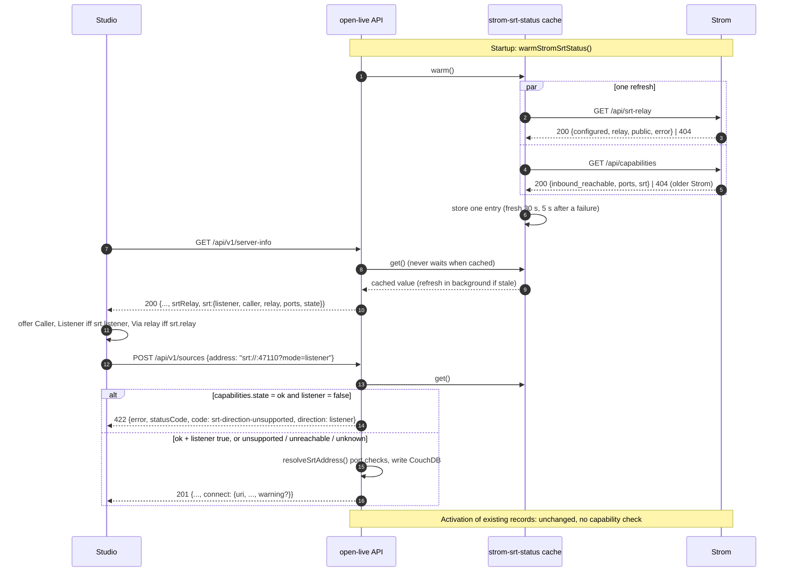

# Spec: Offer only the SRT directions the Strom instance supports

- Issue: [Eyevinn/open-live#628](https://github.com/Eyevinn/open-live/issues/628) — "Only offer the SRT directions the Strom instance supports"
- Status: Draft (architect, epic-workflow Phase 1 — pre-implementation)
- ADR: [ADR-014](../decisions/ADR-014-strom-reported-srt-capabilities.md)
- Repos affected: `Eyevinn/open-live` (backend), `Eyevinn/open-live-studio` (direction and port pickers)
- Upstream dependency: [Eyevinn/strom#1257](https://github.com/Eyevinn/strom/issues/1257) (open, no PR yet)
- Builds on (unmerged): [Eyevinn/open-live#629](https://github.com/Eyevinn/open-live/pull/629) (draft, SRT relay) and
  [Eyevinn/open-live-studio#259](https://github.com/Eyevinn/open-live-studio/pull/259) (draft, "Via relay"),
  which depend on [Eyevinn/strom#1258](https://github.com/Eyevinn/strom/pull/1258) (`GET /api/srt-relay`, open, ready for review)

---

## 1. Problem Statement

The studio offers every SRT direction for sources and outputs (Listener, Caller, and with #629
also Via relay) whether or not it can work on the Strom the production runs on. On a Strom in
Kubernetes, or in Docker on a NAT bridge, a port Strom binds inside the pod cannot be reached from
outside. The operator picks Listener, gets a dial-in address nobody can reach, and nothing says why.

Whether a direction works is a property of how Strom is deployed, so Strom is the one that knows
(strom#1257: `STROM_INBOUND_REACHABLE`, `STROM_PORTS`, `STROM_SRT_RELAY`). Open Live must read it
from Strom, not keep its own copy of the setting. This is the same principle #629 applies to the
SRT relay.

Goals:

1. Open Live reads Strom's SRT capabilities: cached, refreshed in the background, never blocking a
   request, and exposes the effective directions in `GET /api/v1/server-info`.
2. The studio offers only supported directions, and listener ports from Strom's port list when
   Strom reports one.
3. The API refuses to create, or patch to, a direction Strom **positively** reports as
   unsupported. Unknown or unreachable is accepted and flagged on `connect`.
4. Existing sources and outputs in an unsupported direction stay listed and still activate.
5. An older Strom without the endpoint keeps today's behaviour: everything is offered.

Non-goals: WebRTC/WHIP/WHEP (ICE/TURN handle reachability), RTMP (always outbound), the
legacy port broker / reservation flow (`docs/port-reservation.md`, planned for removal; it is
not used as the capability signal), and any change to flow generation or activation.

---

## 2. What exists today (verified)

| Item | Where | State |
|------|-------|-------|
| `GET /api/v1/server-info` → `{ stromHost, srtPorts, srtPortState }` | `src/routes/status.ts:14-28` (main) | merged |
| `server-info.srtRelay { configured, public, state }` | `src/routes/status.ts` on #629 | draft PR |
| Relay status cache (stale-while-revalidate, 30 s TTL, 5 s error TTL, 3 s timeout, 3 s first wait, warm at startup, 404 = not configured) | `src/services/srt-relay-status.ts` on #629 | draft PR |
| `StromClient.system.srtRelay()` → `GET /api/srt-relay` → `{ configured, relay, public, error }` | `src/lib/strom.ts` on #629; Strom side `backend/src/api/srt_relay.rs` on strom#1258 | open PRs |
| One resolver for stored SRT addresses, relay 422 when `relay.state === 'ok' && !relay.configured` | `resolveSrtAddress()` in `src/services/listener-ports.ts` on #629 | draft PR |
| Error body shape for these refusals: `{ error: string, statusCode: number }` | `src/services/listener-ports.ts`, routes | merged + #629 |
| Derived read-only `connect` on SRT outputs | `resolveSrtConnect()` `src/lib/srt-connect.ts`, `src/routes/outputs.ts:205-215` (main) | merged |
| `connect` on SRT sources too, plus relay reasons (`srt-relay-not-configured`, `srt-relay-unreachable`, `srt-relay-public-unknown`) | `src/routes/sources.ts`, `src/lib/srt-connect.ts` on #629 | draft PR |
| Listener detection: hostless `srt://:PORT`, `mode` absent or `listener` | `listenerPortRequest()` `src/services/listener-ports.ts` | merged |
| Strom capabilities endpoint | — | **does not exist** on Strom main or in any PR |

This spec therefore **builds on #629**: its implementation starts from #629's branch state (or
after #629 merges) and generalises #629's relay cache rather than adding a second poller.

---

## 3. Strom contract (dependency on strom#1257)

**Status: proposed, not yet implemented upstream.** strom#1257 lets Strom choose between a new
`GET /api/capabilities` or an extension of `GET /api/srt-relay`. Recommendation to Strom: a new
`GET /api/capabilities`, because `inbound_reachable` describes the host and network rather than
the relay, and other listening blocks (RIST, UDP/RTP, RTMP/RTSP server) will read it too.

### 3.1 Proposed payload (`GET /api/capabilities`, 200)

```jsonc
{
  "inbound_reachable": false,          // STROM_INBOUND_REACHABLE, default true
  "ports": ["47100-47199", "48000"],   // STROM_PORTS as configured; null = any port
  "srt": {
    "listener": false,                 // == inbound_reachable
    "caller": true,                    // always true
    "relay": true                      // STROM_SRT_RELAY configured
  }
}
```

- `ports` entries are `"N"` or `"N-M"` (inclusive), the same syntax as `STROM_PORTS`. Strom does
  not expand ranges (a range can be thousands of ports).
- Same auth as every other Strom API route (Open Live already sends its Strom token).
- A Strom without the feature answers **404**.

### 3.2 How Open Live reads it (tolerant of either upstream choice)

The parser accepts the capabilities object from either place, so whichever option strom#1257
picks needs only a one-line change in the client, not a spec change:

1. `GET /api/capabilities` 200 → use it.
2. Otherwise, if the `GET /api/srt-relay` body (already fetched for #629) carries
   `inbound_reachable` / `srt`, use those fields.
3. Otherwise (404 on capabilities and no fields on srt-relay) → **older Strom** (§4.3).

Field-level fail-open normalisation: `srt.listener` is `false` only when the body says exactly
`false` (or `srt` is absent and `inbound_reachable === false`); `srt.caller` is always treated as
`true`; a `ports` value that is not an array of well-formed `N`/`N-M` strings in 1-65535 is
treated as `null`.

---

## 4. Backend design (open-live)

### 4.1 One cached poller: `services/strom-srt-status.ts`

#629's `srt-relay-status.ts` is generalised (renamed, or kept as a thin re-export) into one
module that holds **one** cached answer for everything Open Live asks Strom about SRT:

- One `lookup()` issues `GET /api/srt-relay` and `GET /api/capabilities` in parallel
  (`Promise.allSettled`, each with the existing 3 s timeout), and writes one cache entry.
- Same timing as #629, unchanged: fresh 30 s, stale-while-revalidate, 5 s retry after a failure,
  one in-flight refresh, warmed at startup (`warmSrtRelayStatus()` becomes `warmStromSrtStatus()`
  in `src/main.ts`), first lookup waits at most 3 s then reads as `unknown`.
- The two halves keep separate states, because they fail independently:

```ts
type StromAnswerState = 'ok' | 'unsupported' | 'unreachable' | 'unknown';

interface StromSrtStatus {
  relay: SrtRelayStatus;          // #629's shape, unchanged: { configured, relay, public, error, state }
  capabilities: {
    state: StromAnswerState;      // 'unsupported' = older Strom (404, §3.2 step 3)
    inboundReachable: boolean | null;  // null unless state === 'ok'
    listener: boolean;            // effective, see §4.3
    caller: true;
    ports: string[] | null;       // Strom's STROM_PORTS ranges, or null
    error: string | null;
  };
}
```

`getSrtRelayStatus()` and `srtRelayInfoFor()` keep their signatures and read from the shared
cache, so #629's callers do not change. A new `getSrtCapabilities()` reads the other half.
No new dependency (plain `fetch` through the existing `StromClient`).

### 4.2 Direction of a stored address

A new pure helper `srtDirection(address): 'listener' | 'caller' | 'relay' | null` in
`src/lib/srt-connect.ts` (next to `parseSrtAuthority`), used by the write gate and `connect`:

| Address | Direction |
|---------|-----------|
| `srt+relay://<id>[?…]` | `relay` |
| `mode=listener` (any host), or hostless with `mode` absent | `listener` |
| host present and `mode` absent or `caller` | `caller` |
| `mode=rendezvous`, non-SRT, malformed | `null` (never gated) |

Applies to sources with `streamType` `srt`/`efp` and outputs with `outputType`
`mpegtssrt`/`efpsrt` — the same set `usedSrtBindings()` scans.

### 4.3 Effective directions and "positively unsupported"

| Capabilities state | `listener` (offered / in server-info) | API refuses a new listener? |
|--------------------|---------------------------------------|-----------------------------|
| `ok`, `srt.listener: true` | `true` | no |
| `ok`, `srt.listener: false` | `false` | **yes, 422** |
| `unsupported` (older Strom, 404) | `true` (today's behaviour) | no |
| `unreachable` (timeout, 5xx, auth) | last known value, `true` if none | no (accept, flag `connect`) |
| `unknown` (no answer yet) | `true` | no (accept, flag `connect`) |

Relay keeps #629's rule unchanged: offered when `relay.configured`; refused with 422 only when
`relay.state === 'ok' && !relay.configured`. When the capabilities object also reports
`srt.relay`, `/api/srt-relay` stays authoritative for relay (it also carries `public`); a
disagreement is logged at `warn` once per change.

Caller is always offered and never refused.

**Only a definite answer from Strom refuses a write.** A refusal is the one outcome that is
wrong if Strom is merely slow, so `unreachable`/`unknown` never refuse, matching #629.

### 4.4 Write gate (create and PATCH)

Lives in `resolveSrtAddress()` (`src/services/listener-ports.ts`, #629), which already receives
the relay status and is the one resolver every SRT write goes through; it gains a
`capabilities` option next to `relay`. Rules:

- **Create** (`POST /api/v1/sources`, `POST /api/v1/outputs`): refused when
  `srtDirection(address)` is positively unsupported (§4.3).
- **PATCH** (`PATCH /api/v1/sources/:id`, `PATCH /api/v1/outputs/:id`): refused only when the
  patch **changes the direction** to a positively unsupported one. A PATCH that keeps the stored
  direction (rename, passphrase change, a port change on an existing listener) is accepted, so
  existing records stay editable (§4.6).
- The check runs before the listener-port checks, so a refused listener never consumes a port
  assignment for `srt://:0`.
- Activation (`flow-generator.ts`, production start) is **not** gated. Unchanged.

### 4.5 Listener ports outside Strom's `ports`

- When the legacy port reservation is active (`srtPortState: 'reserved'`), today's rule stands:
  a listener port outside the reserved set is refused with 422 (existing message, unchanged).
  The reserved set is a subset of `STROM_PORTS`, so this is the stricter check.
- When no reservation is active and Strom reports `ports`: a listener port outside them is
  **accepted** and flagged on `connect.warning = 'srt-listener-port-outside-strom-ports'`. This
  matches strom#1257, where Strom itself warns rather than blocks, and avoids two different
  refusals for the same misconfiguration while the reservation flow is being retired.
- `srt://:0` (server picks) is unchanged: it still needs a reservation (400 without one).
  Choosing from `ports` server-side is out of scope until the reservation flow is removed.

### 4.6 Existing records

- Listed exactly as today (no filtering of `GET /api/v1/sources`, `GET /api/v1/outputs`).
- Activate exactly as today.
- Their `connect` gains `warning` (§5.3) when their direction is positively unsupported, so the
  operator sees why the address may not be dialable.
- The studio edit dialog shows the stored direction but does not offer an unsupported direction
  as a new choice (§6).

---

## 5. API contract

### 5.1 `GET /api/v1/server-info` (unauthenticated, unchanged status codes: 200, 500 on bad `STROM_URL`)

Additive. `stromHost`, `srtPorts`, `srtPortState` (main) and `srtRelay` (#629) are kept verbatim
for existing clients; `srt` is new.

```jsonc
{
  "stromHost": "strom.example.com",
  "srtPorts": null,
  "srtPortState": "disabled",
  "srtRelay": { "configured": true, "public": "relay.example.com:9999", "state": "ok" },
  "srt": {
    "listener": false,
    "caller": true,
    "relay": true,
    "ports": ["47100-47199"],
    "state": "ok"
  }
}
```

| Field | Type | Meaning |
|-------|------|---------|
| `srt.listener` | boolean | Offer Listener. Effective value per §4.3 (`true` unless Strom positively says no, or last-known says no). |
| `srt.caller` | `true` | Always. Present so clients do not hard-code it. |
| `srt.relay` | boolean | Offer Via relay. Same as `srtRelay.configured`. |
| `srt.ports` | string[] \| null | Strom's `STROM_PORTS` ranges (`"N"` / `"N-M"`), or null = any port. |
| `srt.state` | `ok` \| `unsupported` \| `unreachable` \| `unknown` | State of the capabilities half (§4.1). `unsupported` = older Strom. |

Never blocks on Strom (served from cache). Never carries Strom's internal relay address or any
credential. `docs/openapi.yaml` (`getServerInfo`, line ~1574) gets the `srt` object; `required`
stays `[stromHost, srtPorts, srtPortState]` plus `srt` once shipped.

### 5.2 Create / PATCH refusal (sources and outputs)

Endpoints: `POST /api/v1/sources`, `PATCH /api/v1/sources/:id`, `POST /api/v1/outputs`,
`PATCH /api/v1/outputs/:id`.

**422 Unprocessable Entity**, consistent with #629's relay refusal and the existing
"port not reserved" refusal. Body keeps the house shape `{ error, statusCode }` and adds two
machine-readable fields:

```jsonc
{
  "error": "Strom reports that SRT listener ports on this instance are not reachable from outside, so listener addresses cannot be used; use a caller address or srt+relay://auto",
  "statusCode": 422,
  "code": "srt-direction-unsupported",
  "direction": "listener"
}
```

- `direction`: `listener` | `relay`. The message names the alternatives Strom does support
  (relay is mentioned only when `srt.relay` is true).
- #629's relay 422 adopts the same `code` and `direction: "relay"` (additive; its message text
  is unchanged).
- Unchanged codes on these routes: 400 (validation, `srt://:0` without reservation),
  409 (port or relay-id clash), 422 (port not reserved), 503 (reservation pending).
- No new code for `unreachable`/`unknown`: the write succeeds (201/200).

### 5.3 `connect` (derived, read-only, on SRT sources and outputs)

Additive optional field `warning`, present **alongside** a resolved `uri` (unlike `reason`,
which by contract is present only when `uri` is null and stays so):

```ts
type SrtConnectWarning =
  | 'srt-listener-unsupported'               // Strom positively reports listener: false
  | 'srt-capabilities-unknown'               // listener address, Strom capabilities unreachable/unknown
  | 'srt-listener-port-outside-strom-ports'; // §4.5
```

```jsonc
// existing listener output on a Strom that now reports listener: false
"connect": {
  "uri": "srt://strom.example.com:47110?mode=caller",
  "host": "strom.example.com", "port": 47110, "mode": "caller",
  "source": "strom-host",
  "warning": "srt-listener-unsupported"
}
```

Only listener addresses get a capabilities warning; `unsupported` (older Strom) never warns.
Relay addresses keep #629's `reason` values unchanged. Listing never waits on Strom for this:
`connect` reads the cache, and only when the page contains a listener address (mirrors
`srtRelayInfoFor()`).

---

## 6. Studio (open-live-studio)

Reads `server-info.srt` (fetched as today, plus a refetch when a create/edit dialog opens):

- **Direction picker** (source and output dialogs): Caller always; Listener only when
  `srt.listener`; Via relay only when `srt.relay`. If `srt` is absent (older backend), offer
  everything, as today.
- **Port picker** (Listener): if `srtPorts` (reservation) is non-null, offer from it, as today.
  Else if `srt.ports` is non-null, offer ports from those ranges (default: lowest port not used
  by a listed source/output) and allow free entry with an inline warning when outside them.
  Else free entry, as today.
- **Edit dialog** for a record whose stored direction is now unsupported: show the stored
  direction selected and labelled "not supported by this Strom"; switching away is allowed,
  switching back is not offered.
- **List views**: show `connect.warning` as a hint next to the dial-in address.
- **422 `srt-direction-unsupported`**: show `error` and refetch `server-info` (the cache may
  have changed under the dialog).

Builds on studio #259 (which already reads `srtRelay.configured`).

---

## 7. Data model

**No changes.** Nothing is persisted: capabilities are a property of the Strom deployment, read
at request time from cache. `SourceDoc.address` / `OutputDoc.url` keep their current form. No
migration.

---

## 8. Service interactions



---

## 9. Configuration

**open-live: no new env vars.** Cache timings are #629's constants, unchanged.

**Strom (strom#1257, dependency):**

| Env var | Default | Effect seen by Open Live |
|---------|---------|--------------------------|
| `STROM_INBOUND_REACHABLE` | `true` | `false` → `srt.listener: false` → Listener hidden and refused |
| `STROM_PORTS` | unset | reported as `srt.ports` → listener port picker |
| `STROM_SRT_RELAY` | unset | `srt.relay: true` (and `/api/srt-relay` `configured`) → Via relay offered |

No Strom pipeline JSON change: the flow generator is untouched.

---

## 10. Dependencies

No new library. Everything is own code on top of the existing `StromClient` and #629's cache
(roughly one module change, one pure helper, route wiring). Nothing is removed.

---

## 11. Open questions (each with a proposed answer)

1. **Capabilities source and the shared poller.** New `GET /api/capabilities`, or extend
   `GET /api/srt-relay`?
   *Proposed:* ask strom#1257 for `GET /api/capabilities` (not SRT-relay-specific). Open Live
   parses either (§3.2), and fetches both in one refresh of one cache that generalises #629's
   `srt-relay-status.ts` (§4.1), so there is exactly one poller.
2. **`server-info` shape.**
   *Proposed:* add `srt: { listener, caller, relay, ports, state }`; keep `srtPorts`,
   `srtPortState`, `srtRelay` unchanged for existing clients (§5.1).
3. **Refusal code and body.**
   *Proposed:* 422, `{ error, statusCode, code: "srt-direction-unsupported", direction }`, and
   #629's relay 422 adopts the same `code`/`direction` (§5.2).
4. **Positively unsupported versus unknown.**
   *Proposed:* refuse only when the capabilities half is `ok` and says `false`. `unreachable` and
   `unknown` accept and set `connect.warning: "srt-capabilities-unknown"`; `unsupported` (older
   Strom) accepts silently (§4.3).
5. **"Say so in the `connect` reason" when `uri` is resolvable.** `reason` is documented as
   present only when `uri` is null.
   *Proposed:* a new optional `connect.warning` alongside `uri`, rather than overloading `reason`
   (§5.3).
6. **PATCH semantics.**
   *Proposed:* refuse only a PATCH that changes the direction into an unsupported one; a PATCH
   that keeps the stored direction is accepted (§4.4).
7. **Existing records.**
   *Proposed:* still listed, still activate, no change to flow generation; `connect.warning`
   explains (§4.6).
8. **Older Strom detection.**
   *Proposed:* 404 on `/api/capabilities` and no capability fields on `/api/srt-relay` →
   `state: "unsupported"`, offer everything. Any other failure is `unreachable` (§3.2, §4.3).
9. **Listener port outside `STROM_PORTS`.**
   *Proposed:* warn, not refuse (`connect.warning`, studio inline warning), unless the legacy
   reservation is active, where today's 422 stands (§4.5).
10. **Relay source of truth when both endpoints report it.**
    *Proposed:* `/api/srt-relay` stays authoritative (it carries `public`); log a disagreement
    (§4.3).
11. **Sequencing with #629.**
    *Proposed:* implementation starts after #629 merges (or rebases onto it); this spec does not
    re-specify #629's relay behaviour.
12. **Rendezvous mode.**
    *Proposed:* not gated and not offered by the studio, as today (§4.2).

---

## 12. Risks

- **Upstream not built.** strom#1257 has no PR. Until it ships every Strom reads as
  `unsupported` and behaviour is unchanged, so the Open Live side can merge first safely. The
  test "listener refused on `STROM_INBOUND_REACHABLE=false`" needs a stubbed Strom until then.
- **#629 not merged.** This spec reuses its cache, resolver, `connect` on sources, and studio
  #259. If #629 changes shape, §4.1 and §4.4 follow it.
- **Stale cache refuses a write.** A Strom that flips `STROM_INBOUND_REACHABLE` back to `true`
  can be refused for up to 30 s. Acceptable: the change needs a Strom restart anyway; the studio
  refetches on 422.
- **Fail-open parsing** means a malformed Strom answer offers Listener. Deliberate: it matches
  today's behaviour, and the failure mode is the one this issue starts from, not a new one.
- **`STROM_PORTS` overlaps the legacy reservation pool** (`docs/port-reservation.md`), the same
  env var on Strom. While both exist, the reservation is the stricter check (§4.5); when the
  reservation flow is removed, `srt.ports` becomes the only port list and §4.5 should be revisited.
- **The `ports` list can be large** as numbers; it is kept as Strom's range strings.

---

## 13. Test cases (from the issue, made concrete)

| # | Strom | Expectation |
|---|-------|-------------|
| T1 | capabilities `{inbound_reachable:false, srt:{listener:false, caller:true, relay:true}}`, relay configured | `server-info.srt = {listener:false, caller:true, relay:true, state:"ok"}`; `POST /sources` with `srt://:47110?mode=listener` → 422 `srt-direction-unsupported`/`listener`; `srt+relay://auto` → 201 |
| T2 | defaults (`listener:true`) | unchanged behaviour; no `connect.warning` |
| T3 | older Strom (404 on capabilities, 404 or relay-only body on srt-relay) | `srt.state:"unsupported"`, `listener:true`; listener create → 201 |
| T4 | capabilities `ports:["47100-47199"]`, no reservation | `server-info.srt.ports` echoes it; listener on 48000 → 201 with `connect.warning:"srt-listener-port-outside-strom-ports"` |
| T5 | existing listener source; Strom later reports `listener:false` | listed; `connect.warning:"srt-listener-unsupported"`; activation builds the same flow as before; PATCH rename → 200; PATCH caller→listener on another record → 422 |
| T6 | Strom timing out | `srt.state:"unreachable"`, listener create → 201 with `connect.warning:"srt-capabilities-unknown"`; request latency unaffected after warm-up |
| T7 | studio, T1 Strom | direction picker shows Caller and Via relay only |
