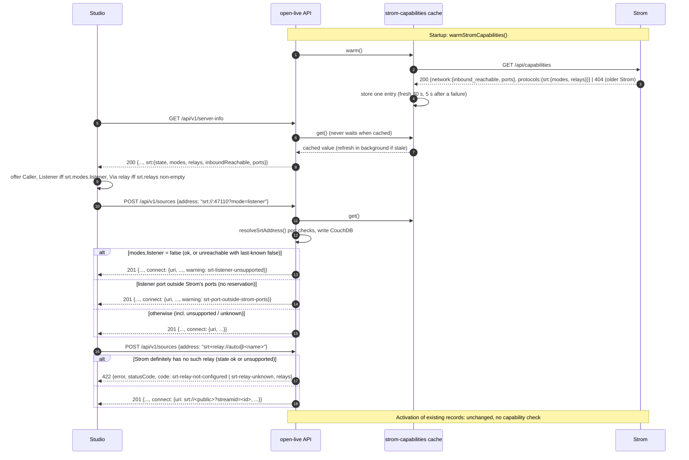

# Spec: Offer only the SRT directions the Strom instance supports

- Issue: [Eyevinn/open-live#628](https://github.com/Eyevinn/open-live/issues/628) — "Only offer the SRT directions the Strom instance supports"
- Status: Implemented (#629, open-live-studio#259)
- ADR: [ADR-014](../decisions/ADR-014-strom-reported-srt-capabilities.md) (Accepted, amended 2026-11-13)
- Repos affected: `Eyevinn/open-live` (backend), `Eyevinn/open-live-studio` (direction and port pickers)
- Upstream dependency: **Strom >= 0.8.2.** [Eyevinn/strom#1257](https://github.com/Eyevinn/strom/issues/1257)
  (closed) shipped as [Eyevinn/strom#1260](https://github.com/Eyevinn/strom/pull/1260)
  (`GET /api/capabilities`, merged) and [Eyevinn/strom#1262](https://github.com/Eyevinn/strom/pull/1262)
  (named SRT relays, merged); both released in Strom v0.8.2 (2026-11-13).
  [Eyevinn/strom#1258](https://github.com/Eyevinn/strom/pull/1258) (`GET /api/srt-relay`) was closed
  unmerged, superseded by #1262.
- Implemented in: [Eyevinn/open-live#629](https://github.com/Eyevinn/open-live/pull/629) (SRT relay and
  this spec, ready for review) and
  [Eyevinn/open-live-studio#259](https://github.com/Eyevinn/open-live-studio/pull/259) ("Via relay",
  direction and port pickers, ready for review). Merge order: #629, check `server-info.srt` on
  staging, then studio#259. #628 closes after both merge.


> **Implementation note (2026-11-13, #629).** Strom settled the contract differently from §3:
> `GET /api/capabilities` (strom#1260 and strom#1262, released in Strom v0.8.2) returns
> `{ network: { inbound_reachable, ports: [{first, last}] | null }, protocols: { srt: { modes:
> { listener, caller, rendezvous }, relays: [{ name, public }] }, webrtc } }`, and
> `GET /api/srt-relay` was removed before release. Relays are named
> (`srt+relay://<id>[@<relay>]`, Strom env `STROM_SRT_RELAY_PUBLIC`, `STROM_SRT_RELAY_INTERNAL`,
> `STROM_SRT_RELAYS`). What Open Live implements on #629, where it differs from this spec:
> one cache over `GET /api/capabilities` only (`src/services/strom-capabilities.ts`);
> `server-info.srt = { state, modes: { listener, caller, rendezvous }, relays: [{ name, public }],
> inboundReachable, ports }` replaces `srtRelay`; SRT modes are **reported, never refused**
> (no `srt-direction-unsupported` 422; `connect.warning` is `srt-listener-unsupported`,
> `srt-rendezvous-unsupported` or `srt-port-outside-strom-ports`); relay refusals are 422 with
> `code` `srt-relay-not-configured` or `srt-relay-unknown` and `relays` (the configured names).
> `docs/openapi.yaml` is the contract; the sections below are kept as the original design, and
> passages that the amendment supersedes are marked inline.
>
> **Amendment decisions (team-lead sign-off,
> [#629 comment](https://github.com/Eyevinn/open-live/pull/629#issuecomment-6859992148)).**
> Against the #630 resolutions:
>
> - *Res. 3/4, 6 (refusal) — accepted as amended:* SRT modes are reported on `connect.warning`,
>   never refused. `STROM_INBOUND_REACHABLE` is one deployment-wide hint, not proof, and knows
>   nothing about NodePort/hostPort/LB forwards set up outside Strom; open-live-ingest's default
>   `caller` uplink registers `srt://:<port>?mode=listener` and a 422 would break it. Create
>   (201) and PATCH (200) on sources and outputs carry `connect.warning` (tested); follow-up
>   [Eyevinn/open-live-ingest#23](https://github.com/Eyevinn/open-live-ingest/issues/23) surfaces
>   it in the gateway.
> - *Res. 3 (relay 422 shape) — accepted as amended:* `code: srt-relay-not-configured |
>   srt-relay-unknown` plus `relays`, no `direction` (a relay address always means the relay
>   direction).
> - *Res. 4 (`srt-capabilities-unknown`) — dropped:* with nothing gated it carries no meaning and
>   would mark every SRT record while Strom is briefly down; `server-info.srt.state` carries the
>   state, and an unreachable Strom still warns from the last-known modes.
> - *Res. 9 (port outside `STROM_PORTS`) — implemented:* `connect.warning:
>   srt-port-outside-strom-ports` (§4.5), the only port signal an API client gets.
> - *Res. 11 (sequencing) — replaced:* #628 is implemented inside #629 (team-lead sign-off), since
>   Strom replaced `/api/srt-relay` with `/api/capabilities` and a separate PR would rewrite the
>   same cache.
> - *Res. 12 (rendezvous):* not offered by the studio; a rendezvous address Strom reports as
>   unsupported is only warned about (`srt-rendezvous-unsupported`).
> - *Res. 13 (`srtDirection`) — amended:* implemented as `srtAddressMode()`; hostless
>   `mode=caller` is a **listener** (GStreamer runs a hostless SRT URI as a listener), not `null`;
>   unit-tested.
> - *Res. 14 (ADR status) — done:* ADR-014 is Accepted (amended 2026-11-13).
> - *Studio:* a stored listener record whose Strom reports `listener: false` shows the
>   `connect.warning` line and keeps Listener selectable in Edit, instead of §6's "not supported
>   by this Strom" label. New records, and records in other directions, get Listener disabled.

---

## 1. Problem Statement

The studio offers every SRT direction for sources and outputs (Listener, Caller, and with #629
also Via relay) whether or not it can work on the Strom the production runs on. On a Strom in
Kubernetes, or in Docker on a NAT bridge, a port Strom binds inside the pod cannot be reached from
outside. The operator picks Listener, gets a dial-in address nobody can reach, and nothing says why.

Whether a direction works is a property of how Strom is deployed, so Strom is the one that knows
(strom#1257: `STROM_INBOUND_REACHABLE`, `STROM_PORTS`, `STROM_SRT_RELAY_PUBLIC` / `STROM_SRT_RELAYS`). Open Live must read it
from Strom, not keep its own copy of the setting. This is the same principle #629 applies to the
SRT relay.

Goals:

1. Open Live reads Strom's SRT capabilities: cached, refreshed in the background, never blocking a
   request, and exposes the effective directions in `GET /api/v1/server-info`.
2. The studio offers only supported directions, and listener ports from Strom's port list when
   Strom reports one.
3. ~~The API refuses to create, or patch to, a direction Strom **positively** reports as
   unsupported.~~ *Amended:* the API accepts it and reports it on `connect.warning` (see the
   amendment decisions above).
4. Existing sources and outputs in an unsupported direction stay listed and still activate.
5. An older Strom without the endpoint keeps today's behaviour: everything is offered.

Non-goals: WebRTC/WHIP/WHEP (ICE/TURN handle reachability), RTMP (always outbound), the
legacy port broker / reservation flow (`docs/port-reservation.md`, planned for removal; it is
not used as the capability signal), and any change to flow generation or activation.

---

## 2. What exists today (verified)

| Item | Where | State |
|------|-------|-------|
| `GET /api/v1/server-info` → `{ stromHost, srtPorts, srtPortState }` | `src/routes/status.ts:14-28` (main) | merged |
| `server-info.srtRelay { configured, public, state }` | `src/routes/status.ts` on #629 | **removed before release**, replaced by `server-info.srt` (#629) |
| Relay status cache (stale-while-revalidate, 30 s TTL, 5 s error TTL, 3 s timeout, 3 s first wait, warm at startup, 404 = not configured) | `src/services/srt-relay-status.ts` on #629 | **replaced** by `src/services/strom-capabilities.ts` (same timings) |
| `StromClient.system.srtRelay()` → `GET /api/srt-relay` → `{ configured, relay, public, error }` | `src/lib/strom.ts` on #629; Strom side strom#1258 | **removed**: strom#1258 closed unmerged; Strom ships `GET /api/capabilities` instead (strom#1260/#1262), read by `StromClient.system.capabilities()` |
| One resolver for stored SRT addresses, relay 422 when Strom definitely has no such relay (`code` `srt-relay-not-configured` / `srt-relay-unknown`, `relays`) | `resolveSrtAddress()` in `src/services/listener-ports.ts` | in #629 |
| Error body shape for these refusals: `{ error: string, statusCode: number }` | `src/services/listener-ports.ts`, routes | merged + #629 |
| Derived read-only `connect` on SRT outputs | `resolveSrtConnect()` `src/lib/srt-connect.ts`, `src/routes/outputs.ts:205-215` (main) | merged |
| `connect` on SRT sources too, plus relay reasons (`srt-relay-not-configured`, `srt-relay-unreachable`, `srt-relay-public-unknown`) | `src/routes/sources.ts`, `src/lib/srt-connect.ts` | in #629 (plus `srt-relay-unknown`) |
| Listener detection: hostless `srt://:PORT`, `mode` absent or `listener` | `listenerPortRequest()` `src/services/listener-ports.ts` | merged |
| Strom capabilities endpoint | — | *(at spec time)* did not exist; now `GET /api/capabilities` (strom#1260/#1262, Strom v0.8.2) |

This spec **builds on #629**: it was implemented inside #629 (team-lead sign-off), which
generalises #629's relay cache into one capabilities cache rather than adding a second poller.

---

## 3. Strom contract (dependency on strom#1257)

> **Superseded:** implemented upstream as `GET /api/capabilities` (strom#1260/#1262, Strom v0.8.2)
> with the shape in the implementation note at the top; `GET /api/srt-relay` does not exist.

*Original proposal (kept for history):* strom#1257 lets Strom choose between a new
`GET /api/capabilities` or an extension of `GET /api/srt-relay`. Recommendation to Strom: a new
`GET /api/capabilities`, because `inbound_reachable` describes the host and network rather than
the relay, and other listening blocks (RIST, UDP/RTP, RTMP/RTSP server) will read it too.

### 3.1 Proposed payload (`GET /api/capabilities`, 200)

```jsonc
{
  "inbound_reachable": false,          // STROM_INBOUND_REACHABLE, default true
  "ports": ["47100-47199", "48000"],   // STROM_PORTS as configured; null = any port
  "srt": {
    "listener": false,                 // == inbound_reachable
    "caller": true,                    // always true
    "relay": true                      // a relay configured (STROM_SRT_RELAY_PUBLIC / STROM_SRT_RELAYS)
  }
}
```

- `ports` entries are `"N"` or `"N-M"` (inclusive), the same syntax as `STROM_PORTS`. Strom does
  not expand ranges (a range can be thousands of ports).
- Same auth as every other Strom API route (Open Live already sends its Strom token).
- A Strom without the feature answers **404**.

### 3.2 How Open Live reads it (tolerant of either upstream choice)

> **Superseded (amendment):** `GET /api/srt-relay` is gone, so there is no fallback (step 2).
> Open Live makes one fetch, `GET /api/capabilities` (`StromClient.system.capabilities()`):
> 200 → `normaliseCapabilities()` (`state: ok`); 404 → older Strom (`state: unsupported`, every
> mode, no relay); any other failure → `unreachable` with the last-known values. Fail-open
> parsing still holds: a mode is unsupported only when Strom says exactly `false`, and a
> malformed relay entry or port span is dropped. See `src/services/strom-capabilities.ts`.

The parser accepts the capabilities object from either place, so whichever option strom#1257
picks needs only a one-line change in the client, not a spec change:

1. `GET /api/capabilities` 200 → use it.
2. Otherwise, if the `GET /api/srt-relay` body (already fetched for #629) carries
   `inbound_reachable` / `srt`, use those fields.
3. Otherwise (404 on capabilities and no fields on srt-relay) → **older Strom** (§4.3).

Field-level fail-open normalisation: `srt.listener` is `false` only when the body says exactly
`false` (or `srt` is absent and `inbound_reachable === false`); `srt.caller` is always treated as
`true`; a `ports` value that is not an array of well-formed `N`/`N-M` strings in 1-65535 is
treated as `null`.

---

## 4. Backend design (open-live)

### 4.1 One cached poller: `services/strom-srt-status.ts`

> **Superseded (amendment):** shipped as `src/services/strom-capabilities.ts`, one cache over
> **one** fetch of `GET /api/capabilities` (no `GET /api/srt-relay`, no parallel halves, no
> `srt-relay-status.ts`). Same timings: fresh 30 s, stale-while-revalidate, 5 s retry after a
> failure, one in-flight refresh, warmed at startup by `warmStromCapabilities()` in
> `src/main.ts`, first lookup waits at most 3 s then reads as `unknown`. Readers:
> `getStromCapabilities()` and `srtCapabilitiesFor(addresses)`. One `state`
> (`ok | unsupported | unreachable | unknown`) and the shape
> `{ state, inboundReachable, ports: [{first, last}] | null, srt: { modes, relays }, error }`.
> The text below is the original design.

#629's `srt-relay-status.ts` is generalised (renamed, or kept as a thin re-export) into one
module that holds **one** cached answer for everything Open Live asks Strom about SRT:

- One `lookup()` issues `GET /api/srt-relay` and `GET /api/capabilities` in parallel
  (`Promise.allSettled`, each with the existing 3 s timeout), and writes one cache entry.
- Same timing as #629, unchanged: fresh 30 s, stale-while-revalidate, 5 s retry after a failure,
  one in-flight refresh, warmed at startup (`warmSrtRelayStatus()` becomes `warmStromSrtStatus()`
  in `src/main.ts`), first lookup waits at most 3 s then reads as `unknown`.
- The two halves keep separate states, because they fail independently:

```ts
type StromAnswerState = 'ok' | 'unsupported' | 'unreachable' | 'unknown';

interface StromSrtStatus {
  relay: SrtRelayStatus;          // #629's shape, unchanged: { configured, relay, public, error, state }
  capabilities: {
    state: StromAnswerState;      // 'unsupported' = older Strom (404, §3.2 step 3)
    inboundReachable: boolean | null;  // null unless state === 'ok'
    listener: boolean;            // effective, see §4.3
    caller: true;
    ports: string[] | null;       // Strom's STROM_PORTS ranges, or null
    error: string | null;
  };
}
```

`getSrtRelayStatus()` and `srtRelayInfoFor()` keep their signatures and read from the shared
cache, so #629's callers do not change. A new `getSrtCapabilities()` reads the other half.
No new dependency (plain `fetch` through the existing `StromClient`).

### 4.2 Direction of a stored address

> **Amended:** shipped as `srtAddressMode(address): 'listener' | 'caller' | 'rendezvous' | null`
> in `src/lib/srt-connect.ts`, used for `connect.warning` only (no write gate). Relay addresses
> are detected separately (`isSrtRelayAddress()`); hostless `mode=caller` is a listener.

A new pure helper `srtDirection(address): 'listener' | 'caller' | 'relay' | null` in
`src/lib/srt-connect.ts` (next to `parseSrtAuthority`), used by the write gate and `connect`:

| Address | Direction |
|---------|-----------|
| `srt+relay://<id>[?…]` | `relay` |
| `mode=listener` (any host), or hostless with `mode` absent | `listener` |
| host present and `mode` absent or `caller` | `caller` |
| `mode=rendezvous`, non-SRT, malformed | `null` (never gated) |

Applies to sources with `streamType` `srt`/`efp` and outputs with `outputType`
`mpegtssrt`/`efpsrt` — the same set `usedSrtBindings()` scans.

### 4.3 Effective directions and "positively unsupported"

*Amended:* the last column no longer applies — the API never refuses a listener; where it said
"yes, 422" (and for `unreachable` with a last-known `false`) the write succeeds with
`connect.warning: srt-listener-unsupported`; `unknown` and `unsupported` give no warning.

| Capabilities state | `listener` (offered / in server-info) | API refuses a new listener? |
|--------------------|---------------------------------------|-----------------------------|
| `ok`, `srt.listener: true` | `true` | no |
| `ok`, `srt.listener: false` | `false` | **yes, 422** |
| `unsupported` (older Strom, 404) | `true` (today's behaviour) | no |
| `unreachable` (timeout, 5xx, auth) | last known value, `true` if none | no (accept, flag `connect`) |
| `unknown` (no answer yet) | `true` | no (accept, flag `connect`) |

~~Relay keeps #629's rule unchanged: offered when `relay.configured`; refused with 422 only when
`relay.state === 'ok' && !relay.configured`. When the capabilities object also reports
`srt.relay`, `/api/srt-relay` stays authoritative for relay (it also carries `public`); a
disagreement is logged at `warn` once per change.~~ *Superseded (amendment):* `/api/srt-relay`
is gone; `GET /api/capabilities` is the only source, and its `srt.relays` (`[{ name, public }]`)
carry the public address. Via relay is offered when `relays` is non-empty; a relay address is
refused with 422 (`srt-relay-not-configured` / `srt-relay-unknown`) only when Strom definitely
lacks it (`state` `ok` or `unsupported`).

Caller is always offered and never refused.

**Only a definite answer from Strom refuses a write.** A refusal is the one outcome that is
wrong if Strom is merely slow, so `unreachable`/`unknown` never refuse, matching #629.

### 4.4 Write gate (create and PATCH)

> **Superseded (amendment, res. 3/4/6):** there is no mode write gate. Only relay addresses are
> refused (422 `srt-relay-not-configured` / `srt-relay-unknown`); modes are reported on
> `connect.warning`. The text below is the original design.

Lives in `resolveSrtAddress()` (`src/services/listener-ports.ts`, #629), which already receives
the relay status and is the one resolver every SRT write goes through; it gains a
`capabilities` option next to `relay`. Rules:

- **Create** (`POST /api/v1/sources`, `POST /api/v1/outputs`): refused when
  `srtDirection(address)` is positively unsupported (§4.3).
- **PATCH** (`PATCH /api/v1/sources/:id`, `PATCH /api/v1/outputs/:id`): refused only when the
  patch **changes the direction** to a positively unsupported one. A PATCH that keeps the stored
  direction (rename, passphrase change, a port change on an existing listener) is accepted, so
  existing records stay editable (§4.6).
- The check runs before the listener-port checks, so a refused listener never consumes a port
  assignment for `srt://:0`.
- Activation (`flow-generator.ts`, production start) is **not** gated. Unchanged.

### 4.5 Listener ports outside Strom's `ports`

- When the legacy port reservation is active (`srtPortState: 'reserved'`), today's rule stands:
  a listener port outside the reserved set is refused with 422 (existing message, unchanged).
  The reserved set is a subset of `STROM_PORTS`, so this is the stricter check.
- When no reservation is active and Strom reports `ports`: a listener port outside them is
  **accepted** and flagged on `connect.warning = 'srt-port-outside-strom-ports'` (implemented
  in #629 under this shorter name; computed from the last-known `ports` while Strom is
  unreachable; `srt-listener-unsupported` wins when Listener itself is unsupported). This
  matches strom#1257, where Strom itself warns rather than blocks, and avoids two different
  refusals for the same misconfiguration while the reservation flow is being retired.
- `srt://:0` (server picks) is unchanged: it still needs a reservation (400 without one).
  Choosing from `ports` server-side is out of scope until the reservation flow is removed.

### 4.6 Existing records

- Listed exactly as today (no filtering of `GET /api/v1/sources`, `GET /api/v1/outputs`).
- Activate exactly as today.
- Their `connect` gains `warning` (§5.3) when their direction is positively unsupported, so the
  operator sees why the address may not be dialable.
- The studio edit dialog shows the stored direction but does not offer an unsupported direction
  as a new choice (§6).

---

## 5. API contract

### 5.1 `GET /api/v1/server-info` (unauthenticated, unchanged status codes: 200, 500 on bad `STROM_URL`)

> **Superseded (amendment):** shipped as `{ stromHost, srtPorts, srtPortState, srt: { state,
> modes: { listener, caller, rendezvous }, relays: [{ name, public }], inboundReachable, ports } }`
> (`src/routes/status.ts`); `srtRelay` was removed before release and `ports` are `{first, last}`
> spans. The example and table below are the original design.

Additive. `stromHost`, `srtPorts`, `srtPortState` (main) and `srtRelay` (#629) are kept verbatim
for existing clients; `srt` is new.

```jsonc
{
  "stromHost": "strom.example.com",
  "srtPorts": null,
  "srtPortState": "disabled",
  "srtRelay": { "configured": true, "public": "relay.example.com:9999", "state": "ok" },
  "srt": {
    "listener": false,
    "caller": true,
    "relay": true,
    "ports": ["47100-47199"],
    "state": "ok"
  }
}
```

| Field | Type | Meaning |
|-------|------|---------|
| `srt.listener` | boolean | Offer Listener. Effective value per §4.3 (`true` unless Strom positively says no, or last-known says no). |
| `srt.caller` | `true` | Always. Present so clients do not hard-code it. |
| `srt.relay` | boolean | Offer Via relay. Same as `srtRelay.configured`. |
| `srt.ports` | string[] \| null | Strom's `STROM_PORTS` ranges (`"N"` / `"N-M"`), or null = any port. |
| `srt.state` | `ok` \| `unsupported` \| `unreachable` \| `unknown` | State of the capabilities half (§4.1). `unsupported` = older Strom. |

Never blocks on Strom (served from cache). Never carries Strom's internal relay address or any
credential. `docs/openapi.yaml` (`getServerInfo`, line ~1574) gets the `srt` object; `required`
stays `[stromHost, srtPorts, srtPortState]` plus `srt` once shipped.

### 5.2 Create / PATCH refusal (sources and outputs)

> **Superseded (amendment, res. 3):** no `srt-direction-unsupported` 422 shipped. Create and PATCH
> return 201/200 with `connect.warning`; the relay 422 uses `code` `srt-relay-not-configured` /
> `srt-relay-unknown` plus `relays`, with no `direction`. See `docs/openapi.yaml`.

Endpoints: `POST /api/v1/sources`, `PATCH /api/v1/sources/:id`, `POST /api/v1/outputs`,
`PATCH /api/v1/outputs/:id`.

**422 Unprocessable Entity**, consistent with #629's relay refusal and the existing
"port not reserved" refusal. Body keeps the house shape `{ error, statusCode }` and adds two
machine-readable fields:

```jsonc
{
  "error": "Strom reports that SRT listener ports on this instance are not reachable from outside, so listener addresses cannot be used; use a caller address or srt+relay://auto",
  "statusCode": 422,
  "code": "srt-direction-unsupported",
  "direction": "listener"
}
```

- `direction`: `listener` | `relay`. The message names the alternatives Strom does support
  (relay is mentioned only when `srt.relay` is true).
- #629's relay 422 adopts the same `code` and `direction: "relay"` (additive; its message text
  is unchanged).
- Unchanged codes on these routes: 400 (validation, `srt://:0` without reservation),
  409 (port or relay-id clash), 422 (port not reserved), 503 (reservation pending).
- No new code for `unreachable`/`unknown`: the write succeeds (201/200).

### 5.3 `connect` (derived, read-only, on SRT sources and outputs)

Additive optional field `warning`, present **alongside** a resolved `uri` (unlike `reason`,
which by contract is present only when `uri` is null and stays so):

```ts
type SrtConnectWarning =
  | 'srt-listener-unsupported'               // Strom positively reports listener: false
  | 'srt-capabilities-unknown'               // superseded: dropped (amendment, res. 4)
  | 'srt-listener-port-outside-strom-ports'; // §4.5; shipped as 'srt-port-outside-strom-ports'
// As shipped (#629): 'srt-listener-unsupported' | 'srt-rendezvous-unsupported'
//                  | 'srt-port-outside-strom-ports'
```

```jsonc
// existing listener output on a Strom that now reports listener: false
"connect": {
  "uri": "srt://strom.example.com:47110?mode=caller",
  "host": "strom.example.com", "port": 47110, "mode": "caller",
  "source": "strom-host",
  "warning": "srt-listener-unsupported"
}
```

Only listener addresses get a capabilities warning; `unsupported` (older Strom) never warns.
Relay addresses keep #629's `reason` values unchanged. Listing never waits on Strom for this:
`connect` reads the cache, and only when the page contains a listener address (mirrors
`srtRelayInfoFor()`).

---

## 6. Studio (open-live-studio)

Reads `server-info.srt` (fetched as today, plus a refetch when a create/edit dialog opens).
*Amended:* the shipped shape is `srt.modes.listener` / `srt.relays` (non-empty = Via relay),
see §5.1:

- **Direction picker** (source and output dialogs): Caller always; Listener only when
  `srt.listener`; Via relay only when `srt.relay`. If `srt` is absent (older backend), offer
  everything, as today.
- **Port picker** (Listener): if `srtPorts` (reservation) is non-null, offer from it, as today.
  Else if `srt.ports` is non-null, offer ports from those ranges (default: lowest port not used
  by a listed source/output) and allow free entry with an inline warning when outside them.
  Else free entry, as today.
- **Edit dialog** for a record whose stored direction is now unsupported: ~~show the stored
  direction selected and labelled "not supported by this Strom"; switching away is allowed,
  switching back is not offered.~~ *Superseded (amendment, studio decision):* a stored listener
  record whose Strom reports `listener: false` shows the `connect.warning` line and keeps
  Listener selectable in Edit; new records, and records in other directions, get Listener
  disabled.
- **List views**: show `connect.warning` as a hint next to the dial-in address.
- ~~**422 `srt-direction-unsupported`**: show `error` and refetch `server-info` (the cache may
  have changed under the dialog).~~ *Superseded (amendment):* that 422 does not exist; a
  create/PATCH in an unsupported mode succeeds (201/200) and the dialog shows the response's
  `connect.warning`. The only SRT 422s are the relay refusals (`srt-relay-not-configured` /
  `srt-relay-unknown`) and the legacy "port not reserved".

Builds on studio #259 (which already reads `srtRelay.configured`).

---

## 7. Data model

**No changes.** Nothing is persisted: capabilities are a property of the Strom deployment, read
at request time from cache. `SourceDoc.address` / `OutputDoc.url` keep their current form. No
migration.

---

## 8. Service interactions

> **Amended:** updated to the shipped behaviour — one fetch of `GET /api/capabilities` (no
> `GET /api/srt-relay`), and no `422 srt-direction-unsupported` branch: an unsupported mode is
> accepted with `connect.warning`. The only refusal shown is the relay 422.



---

## 9. Configuration

**open-live: no new env vars.** Cache timings are #629's constants, unchanged.

**Strom (strom#1257, dependency):**

| Env var | Default | Effect seen by Open Live |
|---------|---------|--------------------------|
| `STROM_INBOUND_REACHABLE` | `true` | `false` → `srt.modes.listener: false` → Listener not offered for new records; the API accepts it with `connect.warning: srt-listener-unsupported` (amended: originally "hidden and refused") |
| `STROM_PORTS` | unset | reported as `srt.ports` → listener port picker |
| `STROM_SRT_RELAY_PUBLIC`, `STROM_SRT_RELAYS` | unset | `srt.relays` non-empty (`[{ name, public }]`) → Via relay offered |

No Strom pipeline JSON change: the flow generator is untouched.

---

## 10. Dependencies

No new library. Everything is own code on top of the existing `StromClient` and #629's cache
(roughly one module change, one pure helper, route wiring). Nothing is removed.

---

## 11. Open questions (each with a proposed answer)

1. **Capabilities source and the shared poller.** New `GET /api/capabilities`, or extend
   `GET /api/srt-relay`? *Superseded (amendment):* Strom shipped `GET /api/capabilities` and
   removed `/api/srt-relay`; one cache, one fetch (§4.1).
   *Proposed:* ask strom#1257 for `GET /api/capabilities` (not SRT-relay-specific). Open Live
   parses either (§3.2), and fetches both in one refresh of one cache that generalises #629's
   `srt-relay-status.ts` (§4.1), so there is exactly one poller.
2. **`server-info` shape.** *Superseded (amendment):* `srt: { state, modes, relays,
   inboundReachable, ports }`; `srtRelay` removed before release (§5.1).
   *Proposed:* add `srt: { listener, caller, relay, ports, state }`; keep `srtPorts`,
   `srtPortState`, `srtRelay` unchanged for existing clients (§5.1).
3. **Refusal code and body.** *Superseded (amendment):* no mode refusal; relay 422 uses its own
   codes plus `relays`.
   *Proposed:* 422, `{ error, statusCode, code: "srt-direction-unsupported", direction }`, and
   #629's relay 422 adopts the same `code`/`direction` (§5.2).
4. **Positively unsupported versus unknown.** *Superseded (amendment):* nothing is refused and
   `srt-capabilities-unknown` was dropped; unreachable warns from the last-known modes.
   *Proposed:* refuse only when the capabilities half is `ok` and says `false`. `unreachable` and
   `unknown` accept and set `connect.warning: "srt-capabilities-unknown"`; `unsupported` (older
   Strom) accepts silently (§4.3).
5. **"Say so in the `connect` reason" when `uri` is resolvable.** `reason` is documented as
   present only when `uri` is null.
   *Proposed:* a new optional `connect.warning` alongside `uri`, rather than overloading `reason`
   (§5.3).
6. **PATCH semantics.** *Superseded (amendment):* no PATCH is refused for its mode; a PATCH into
   an unsupported mode is 200 with `connect.warning`.
   *Proposed:* refuse only a PATCH that changes the direction into an unsupported one; a PATCH
   that keeps the stored direction is accepted (§4.4).
7. **Existing records.**
   *Proposed:* still listed, still activate, no change to flow generation; `connect.warning`
   explains (§4.6).
8. **Older Strom detection.** *Amended:* 404 on `/api/capabilities` → `unsupported`
   (`/api/srt-relay` is not read); any other failure → `unreachable`.
   *Proposed:* 404 on `/api/capabilities` and no capability fields on `/api/srt-relay` →
   `state: "unsupported"`, offer everything. Any other failure is `unreachable` (§3.2, §4.3).
9. **Listener port outside `STROM_PORTS`.** *Implemented:* `connect.warning:
   srt-port-outside-strom-ports` (§4.5).
   *Proposed:* warn, not refuse (`connect.warning`, studio inline warning), unless the legacy
   reservation is active, where today's 422 stands (§4.5).
10. **Relay source of truth when both endpoints report it.** *Superseded (amendment):* moot,
    `GET /api/capabilities` (`srt.relays` with `public`) is the only source.
    *Proposed:* `/api/srt-relay` stays authoritative (it carries `public`); log a disagreement
    (§4.3).
11. **Sequencing with #629.**
    *Decided:* implemented inside #629 (team-lead sign-off), replacing #630 resolution 11; this
    spec does not re-specify #629's relay behaviour.
12. **Rendezvous mode.**
    *Decided:* not offered by the studio and never refused; a rendezvous address Strom reports as
    unsupported is only warned about (`srt-rendezvous-unsupported`).
13. **`srtDirection`.** *Decided (amended):* shipped as `srtAddressMode()`; hostless
    `mode=caller` is a listener, not `null` (unit-tested).
14. **ADR status.** *Done:* ADR-014 Accepted (amended 2026-11-13) in #629.

---

## 12. Risks

- **Upstream not built.** *(Resolved: shipped in Strom v0.8.2.)* strom#1257 has no PR. Until it ships every Strom reads as
  `unsupported` and behaviour is unchanged, so the Open Live side can merge first safely. The
  test "listener refused on `STROM_INBOUND_REACHABLE=false`" needs a stubbed Strom until then.
- **#629 not merged.** *(Resolved: implemented inside #629.)* This spec reuses its cache, resolver, `connect` on sources, and studio
  #259. If #629 changes shape, §4.1 and §4.4 follow it.
- **Stale cache refuses a write.** *(Superseded: modes are never refused; a stale cache can
  only show a stale `connect.warning` for up to 30 s.)* A Strom that flips `STROM_INBOUND_REACHABLE` back to `true`
  can be refused for up to 30 s. Acceptable: the change needs a Strom restart anyway; the studio
  refetches on 422.
- **Fail-open parsing** means a malformed Strom answer offers Listener. Deliberate: it matches
  today's behaviour, and the failure mode is the one this issue starts from, not a new one.
- **`STROM_PORTS` overlaps the legacy reservation pool** (`docs/port-reservation.md`), the same
  env var on Strom. While both exist, the reservation is the stricter check (§4.5); when the
  reservation flow is removed, `srt.ports` becomes the only port list and §4.5 should be revisited.
- **The `ports` list can be large** as numbers; it is kept as Strom's range strings.

---

## 13. Test cases (from the issue, made concrete)

| # | Strom | Expectation |
|---|-------|-------------|
| T1 | capabilities `{network:{inbound_reachable:false}, protocols:{srt:{modes:{listener:false, caller:true, …}, relays:[{name:"default", public:…}]}}}` | `server-info.srt = {state:"ok", modes:{listener:false, caller:true, …}, relays:[{name:"default", public:…}], inboundReachable:false, …}`; `POST /sources` with `srt://:47110?mode=listener` → **201** with `connect.warning:"srt-listener-unsupported"` (*amended:* originally 422 `srt-direction-unsupported`); `srt+relay://auto` → 201 |
| T2 | defaults (`listener:true`) | unchanged behaviour; no `connect.warning` |
| T3 | older Strom (404 on `GET /api/capabilities`; *amended:* `/api/srt-relay` is not read) | `srt.state:"unsupported"`, every mode true, `relays:[]`; listener create → 201, no warning |
| T4 | capabilities `ports:[{first:47100, last:47199}]`, no reservation | `server-info.srt.ports` echoes it; listener on 48000 → 201 (PATCH → 200) with `connect.warning:"srt-port-outside-strom-ports"` (*amended:* shipped name; originally `srt-listener-port-outside-strom-ports`); with an active reservation the existing 422 applies instead |
| T5 | existing listener source; Strom later reports `listener:false` | listed; `connect.warning:"srt-listener-unsupported"`; activation builds the same flow as before; PATCH rename → 200; PATCH caller→listener on another record → **200** with `connect.warning:"srt-listener-unsupported"` (*amended:* originally 422) |
| T6 | Strom timing out | `srt.state:"unreachable"` (last-known values), listener create → **201**; no `srt-capabilities-unknown` (*amended:* dropped); a warning only from the last-known modes/ports (e.g. `srt-listener-unsupported` if Strom last said `listener:false`); no answer yet (`unknown`) → no warning; request latency unaffected after warm-up |
| T7 | studio, T1 Strom | direction picker for a new record shows Caller and Via relay only (a stored listener keeps Listener selectable in Edit, §6) |
