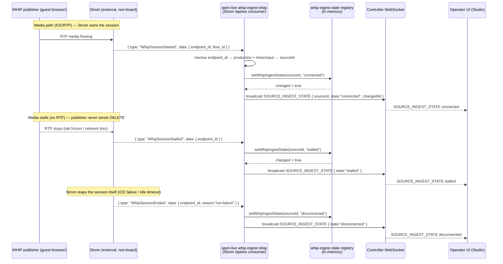

# Spec: Full WHIP ingest status via Strom session events

**Issue**: Eyevinn/open-live#440 (split from epic #437; classification: cross-service)
**Depends on**: ADR-008 (`docs/decisions/ADR-008-whip-ingest-status-strom-session-events.md`)
**Supersedes the interim**: issue #439 (shipped) — see §"Relationship to the interim #439 implementation"
**Status**: Draft — Phase 1 (epic-workflow.md). BLOCKED on an upstream Strom dependency that does not exist yet (see §6).

---

## 1. Problem Statement

`open-live` needs to tell a live operator which WHIP publishers (remote guests, contribution
feeds) are actually *sending media right now*, distinct from the client-writable catalogue
`status` on a source.

The interim implementation (#439, already shipped) derives this entirely from `open-live`'s
own WHIP signaling proxy (`src/routes/whip.ts`):

- a source is marked `connected` when its WHIP **offer POST** succeeds
  (`proxyWhipOffer` → `reflectWhipIngestState(..., 'connected')`, `src/routes/whip.ts:175`), and
- `disconnected` when the WHIP **session DELETE** (teardown) is proxied
  (`proxyWhipDelete` → `reflectWhipIngestState(..., 'disconnected')`, `src/routes/whip.ts:216`).

The state lives in an in-memory registry (`src/services/whip-ingest-state.ts`), is exposed
read-only as `liveIngest` on source REST responses (`src/routes/sources.ts:286-289`), and is
broadcast as `SOURCE_INGEST_STATE` on the controller WebSocket (`src/routes/whip.ts:126-131`,
replayed on connect at `src/ws/controller.ts:3561-3573`).

**The gap this spec closes** is stated explicitly in the interim module's own header
(`src/services/whip-ingest-state.ts:10-15`): because it only observes the proxy's own
offer/teardown traffic, *a publisher that drops WITHOUT sending a DELETE — a closed browser
tab, a network loss, a crash, or a session Strom reaps itself on ICE failure / idle timeout —
stays `connected` forever*. Those sessions never round-trip the `open-live` proxy, so `open-live`
has no signal to flip them to `disconnected`, and the operator sees a frozen "connected" guest
that is actually gone.

The robust fix is to key the ingest state off **real Strom WHIP session lifecycle events** —
which Strom emits for every session it owns, including the ones it tears down itself — so
`open-live` sees start / stall / resume / end regardless of whether the publisher politely
closed through the proxy. This additionally gives us a genuine **`stalled`** signal (media
flowing then stopping without the session ending) that the proxy-only approach fundamentally
cannot observe.

The central constraint: **the Strom WHIP session event does not exist today.** Strom is an
external, NON-board repository (`Eyevinn/strom`), and emitting this event is upstream work that
must be defined/confirmed and merged there before this design can be implemented. This spec
defines the contract `open-live` is built *against* and is a requirement on Strom; see §6.

---

## 2. API Design

Three surfaces change. All are **additive** and widen existing #439 shapes — a client that
ignores the new `stalled` value keeps working.

### 2.1 Read-only ingest-state field on a source (REST)

Unchanged field name and location (`liveIngest` on `GET /api/v1/sources` and
`GET /api/v1/sources/:id`, projected in `toApi()` at `src/routes/sources.ts:286-289`), widened
`state` enum:

```jsonc
// GET /api/v1/sources/:id  (excerpt)
{
  "id": "src-...",
  "status": "active",            // client-writable catalogue status — NEVER overwritten
  "liveIngest": {                // read-only, server-observed; absent until first event
    "state": "connected",        // "connected" | "stalled" | "disconnected"   <- "stalled" is NEW
    "changedAt": "2026-10-16T12:00:00.000Z"
  }
}
```

- Read-only and write-ignored: `liveIngest` is not in `SourceInput` / `SourcePatch`
  (`src/routes/sources.ts:121-165`), so a client-supplied value is dropped and can never
  overwrite `status`. This invariant is already covered by
  `src/__tests__/whip-ingest-state.test.ts` and must be kept.
- Present only once at least one session event has been observed for the source; absent
  otherwise (unchanged from #439).
- `openapi.yaml` `liveIngest.state` enum (`docs/openapi.yaml:201-203`) widens from
  `[connected, disconnected]` to `[connected, stalled, disconnected]`.

### 2.2 Controller-WS state-change message (verified shape)

Unchanged message type and fields (`SOURCE_INGEST_STATE`, documented at
`docs/controller-websocket.md:216`, emitted via `broadcast()` from `src/routes/whip.ts:126-131`
and replayed on connect from `src/ws/controller.ts:3565-3570`), widened `state`:

```jsonc
{
  "type": "SOURCE_INGEST_STATE",
  "sourceId": "src-...",
  "state": "stalled",            // "connected" | "stalled" | "disconnected"   <- "stalled" is NEW
  "changedAt": "2026-10-16T12:00:00.000Z"
}
```

- Broadcast only on a *real* change (the `setWhipIngestState()` return flag,
  `src/services/whip-ingest-state.ts:44-49`); a same-state repeat refreshes `changedAt` but
  does not broadcast.
- The current state of each assigned source is replayed in the connect-time snapshot
  (`src/ws/controller.ts:3561-3573`), unchanged.
- `broadcast()` takes `message: unknown` (`src/services/tally.service.ts`), so there is no
  outgoing union to extend — the widened `state` value is accepted as-is (same pattern as the
  `applied: true` additive flag, repo-patterns.md §"Audio mix changes are broadcast twice").

No new inbound (client→server) message is introduced; ingest state is server-observed only.

### 2.3 REQUIRED upstream Strom WHIP session-event contract (the dependency)

This is the contract `open-live` is built *against* and is a **requirement on upstream Strom**,
not something `open-live` can satisfy itself. It does not exist in Strom today (§6). The shape
below follows the precedent already set in this repo for a not-yet-merged Strom event — the
`PipelineError` consumer (`src/lib/strom.ts:708-721`), whose own comment notes "the Strom
companion change that emits it is not yet merged, so field names follow the issue, not a
verified `events.rs` variant." The `WhipSession*` names/fields here are **proposed** on the same
footing and must be reconciled with Strom's actual `types/src/events.rs` before implementation.

Strom already exposes a flow-event WebSocket at `/api/ws`
(`StromClient.connectWebSocket`, `src/lib/strom.ts:1170-1194`). Every frame uses the
externally-tagged envelope `#[serde(tag = "type", content = "data")]` →
`{ "type": "<Variant>", "data": { ... } }` (confirmed for existing variants at
`src/lib/strom.ts:683-722`). The new variants join the `FlowEvent` union on that same socket:

```ts
// PROPOSED additions to FlowEvent (src/lib/strom.ts) — pending a verified Strom events.rs variant.
| { type: 'WhipSessionStarted';   data: { endpoint_id: string; resource_id?: string; flow_id?: string } }
| { type: 'WhipSessionStalled';   data: { endpoint_id: string; resource_id?: string; flow_id?: string } }
| { type: 'WhipSessionResumed';   data: { endpoint_id: string; resource_id?: string; flow_id?: string } }
| { type: 'WhipSessionEnded';     data: { endpoint_id: string; resource_id?: string; flow_id?: string;
                                          reason?: 'client' | 'ice-failure' | 'idle-timeout' | 'error' } }
```

Hard requirements on the Strom event (what makes it "robust"):

1. **`endpoint_id` is mandatory** and is the WHIP endpoint id Strom serves, i.e. the final path
   segment `open-live` already constructs in `resolveStromWhipUrl()`
   (`src/routes/whip.ts:92-97`): `whip-{padIndex}-{endpointSuffix}`. This is the join key back to
   a production + mixerInput + source (§3.2). Without it the event cannot be routed.
2. **End events must fire for sessions Strom cleans up itself** — ICE failure, the ~10 s
   inactivity reaper (repo-patterns.md §"Strom ends a WHIP publish only on the session
   RESOURCE…"), and any internal error — not only for a client/proxy-driven DELETE. This is the
   entire point of the dependency; a `WhipSessionEnded` that only fired on explicit DELETE would
   add nothing over #439.
3. **Stall/resume semantics must be defined by Strom** (what RTP-timeout / keyframe-gap
   threshold constitutes a stall, and whether a resume is guaranteed before an end). `open-live`
   treats them as opaque edges and must not assume a stall is always followed by a resume or an
   end. The exact threshold is an upstream decision (§6, OQ-2).

State-transition mapping `open-live` applies (see §3.1 for the enum):

| Strom event           | `open-live` ingest state |
|-----------------------|--------------------------|
| `WhipSessionStarted`  | `connected`              |
| `WhipSessionResumed`  | `connected`              |
| `WhipSessionStalled`  | `stalled`                |
| `WhipSessionEnded`    | `disconnected`           |

`reason` on `WhipSessionEnded`, if Strom provides it, is logged for diagnostics but does not
change the resulting `disconnected` state in v1 (it could later annotate the broadcast — OQ-4).

---

## 3. Data Model

### 3.1 Per-source live ingest state (in-memory, widened)

The existing in-memory registry `src/services/whip-ingest-state.ts` is reused and the state type
widened by one value:

```ts
// src/services/whip-ingest-state.ts
export type WhipIngestState = 'connected' | 'stalled' | 'disconnected';   // 'stalled' is NEW

export interface WhipIngestSnapshot {
  state: WhipIngestState;
  changedAt: string;   // ISO-8601 UTC of the last transition
}
// Map<sourceId, WhipIngestSnapshot>; setWhipIngestState() returns `true` only on a real change.
```

- **Where it lives / persistence**: process memory only, keyed by `sourceId`. **No persistence,
  no migration** — it resets to empty on restart, the same trade-off the interim already
  documents (`src/services/whip-ingest-state.ts:17-21`) and shared with the HTML-source param
  registry. A restart loses in-flight publishers' state until the next event re-establishes it;
  because the robust version is event-driven, Strom re-announcing or the next stall/end rebuilds
  it (unlike #439, which could only recover on the next offer/teardown).
- **No CouchDB / `SourceDoc` change**: ingest state is live and ephemeral; it must never be
  conflated with the persisted, client-writable `SourceDoc.status` (`src/db/types.ts:161-204`).
  No new `ProductionDoc` field either.
- `clearWhipIngestState()` stays test-only.

### 3.2 Endpoint → production → mixerInput → source resolution (no new persisted state)

To route an event carrying only `endpoint_id` back to a `sourceId`, `open-live` reuses data it
already derives — it does **not** need to reverse the lossy `endpointSuffix` truncation:

- For each active production, `open-live` can compute each WHIP assignment's endpoint id with the
  existing `resolveStromWhipUrl(productionId, mixerInput)` (`src/routes/whip.ts:92-97`) and index
  `endpoint_id → { productionId, mixerInput }`.
- `mixerInput → sourceId` is the exact lookup the interim already does:
  `production.sources.find(s => s.mixerInput === mixerInput)?.sourceId`
  (`src/routes/whip.ts:122-123`). (For a WHIP guest slot this `sourceId` is the virtual `'Whip'`
  assignment, `src/routes/productions.ts:509`; the registry keys off whatever `sourceId` the
  assignment carries, exactly as today.)

This index is built from live production docs (held in the same per-production WS relay that
already owns the Strom socket — §4) and rebuilt on activation/source-assignment change. It is
derived, not persisted, so there is no migration. The `endpointSuffix = productionId.slice(0,8)`
truncation makes the id non-unique in principle (two productions sharing the first 8 id chars and
a pad index collide) — a **pre-existing** property of `resolveStromWhipUrl`, called out as a risk
in §7 / OQ-3 rather than introduced here.

---

## 4. Service Interactions

The WHIP session events arrive on the **same Strom `/api/ws` flow-event socket** the meter and
clip relays already consume (`src/services/meter-relay.ts:48`, `src/services/clip-relay.ts:193`,
one ref-counted, auto-reconnecting WS per production). The robust consumer is modelled on those
relays: a `whip-ingest-relay` that subscribes to the `WhipSession*` variants, resolves
`endpoint_id → sourceId`, updates the registry, and broadcasts on a real change.



Key interaction notes:

- The event path is **independent of the proxy path**. The existing `reflectWhipIngestState`
  calls in `src/routes/whip.ts` (offer→connected, DELETE→disconnected) can remain as a fast-path
  optimisation, but Strom's events become authoritative; a conflict resolves to the most recent
  event by `changedAt`. (Whether to keep or remove the proxy fast-path is OQ-5.)
- **Subscription lifetime is the main design question** (OQ-1). The meter/clip relays only run
  while an operator controller is connected (ref-counted at connect, torn down on last
  disconnect). But a session Strom reaps on idle timeout can happen with *no* controller
  connected, so a relay scoped to controller connections would miss exactly the events this epic
  exists to catch — the registry would be correct for broadcasts (which only matter with a client
  present) but the REST `liveIngest` field could be stale for a reconnecting client. Two options,
  decided in ADR-008 §Decision / flagged in OQ-1:
  - **(A)** extend the existing per-production relay (cheap, reuses ref-count + reconnect, but
    inherits the controller-scoped lifetime gap above); or
  - **(B)** a single instance-wide Strom WS subscription for WHIP session events that runs for the
    process lifetime, independent of controllers, so ingest state is always current.
  The spec recommends **(B)** for correctness; see ADR-008.

---

## 5. Configuration

No new required configuration. The relay reuses the existing Strom connection config:

- `STROM_URL` (`config.stromUrl`, `src/config.ts:118`) and the public-URL rewrite
  (`STROM_PUBLIC_URL`, `src/config.ts:95`).
- `STROM_AUTH_TOKEN` / `STROM_TOKEN` (`config.stromToken`, `src/config.ts:127`), fetched via
  `getStromToken()` exactly as the meter/clip relays do.
- The event arrives on `/api/ws` (`StromClient.connectWebSocket`, `src/lib/strom.ts:1171`); no new
  endpoint or socket.

Proposed optional env (nice-to-have, default-off so behaviour is unchanged until Strom ships the
event — can be deferred to implementation):

- `WHIP_INGEST_STALL_GRACE_MS` — optional debounce before a `WhipSessionStalled` is surfaced as
  `stalled`, to avoid flapping on a brief RTP gap. Default `0` (surface immediately) if the
  Strom-side threshold (OQ-2) already debounces.

**Strom JSON shape**: the only Strom-side "shape" is the new `WhipSession*` event envelope
defined in §2.3 — which is upstream Strom's to define/emit (§6). `open-live` adds no new request
body to Strom.

---

## 6. Open Questions

**OQ-1 (BLOCKING — the central question). The Strom WHIP session event does not exist today.**
Its exact contract (variant names, `data` fields, `endpoint_id` format guarantee, stall/resume
semantics, and whether end events truly fire for Strom-internal cleanup) must be **defined and
confirmed upstream in `Eyevinn/strom`** and merged before any `open-live` implementation can be
validated against a real event. Strom is an external, NON-board repository; the agent team cannot
land this change there. This needs **upstream Strom work plus human / product sign-off** and is
the gate for the whole epic (#437 is unblocked only once this dependency is resolved — the spec
PR deliberately does **not** close #440). The §2.3 names/fields are a *proposal* on the same
not-yet-verified footing as the existing `PipelineError` consumer (`src/lib/strom.ts:708-721`)
and will change to match Strom's actual `types/src/events.rs`.

**OQ-2.** What exactly constitutes a *stall* in Strom (RTP inactivity window? keyframe gap?), and
is a `WhipSessionResumed` guaranteed to precede a `WhipSessionEnded` after a stall, or can a
stalled session go straight to ended? This determines whether `open-live` needs its own
`WHIP_INGEST_STALL_GRACE_MS` debounce (§5). Upstream decision.

**OQ-3.** `resolveStromWhipUrl` truncates the production id to 8 chars
(`productionId.slice(0,8)`, `src/routes/whip.ts:95`), so `endpoint_id` is not guaranteed unique
across productions (collision for two productions sharing the first 8 id chars and a pad index).
This is **pre-existing** (it already affects WHIP publish routing, not just status), but the robust
status feature makes a mis-route visible. Do we (a) accept the astronomically-low collision risk,
(b) lengthen the suffix, or (c) have Strom echo `flow_id` so we disambiguate by the owning flow?
Option (c) is cheap if Strom includes `flow_id` (already proposed optional in §2.3).

**OQ-4.** Should `WhipSessionEnded.reason` (ice-failure / idle-timeout / client / error) be
surfaced to the operator (e.g. an optional `reason` on `SOURCE_INGEST_STATE` and `liveIngest`) so
Studio can distinguish "guest left" from "guest's connection failed"? Deferred to v2 unless PM
wants it in v1 — additive, non-breaking.

**OQ-5.** Keep or remove the #439 proxy fast-path (`reflectWhipIngestState` in
`src/routes/whip.ts`)? Keeping it gives an instant `connected` on offer without waiting for
Strom's event; removing it makes Strom the single source of truth. Recommendation: keep offer→
`connected` as an optimistic fast-path, let Strom events be authoritative for stall/end.

**OQ-6.** Relay lifetime — option (A) controller-scoped vs (B) instance-wide (§4). Recommended
(B); confirm with team-lead given the small always-on Strom WS cost.

---

## 7. Risks

Drawn from `docs/repo-patterns.md` and the lifecycle-health precedent:

- **Stale "connected" is the status quo, not a regression.** Until Strom ships the event, the
  interim #439 limitation stands (a dropped-without-DELETE publisher reads `connected`). This spec
  does not worsen anything; it is the fix, gated on Strom. If the event is only *partially*
  implemented upstream (e.g. end fires but stall does not), `open-live` degrades gracefully to
  #439-equivalent behaviour for the missing edges.
- **A `degraded`/`stalled` value with no verified source was explicitly rejected before.**
  `docs/specs/production-lifecycle-health.md:122-134` records that output health shipped
  **without** `degraded` precisely because "there is no code-verified source for a per-output
  `degraded` distinction." The `stalled` value here is only justified *because* the Strom session
  event is defined to carry a stall edge — so `stalled` must not ship until that upstream signal
  is real (OQ-1/OQ-2). Shipping `stalled` with no event behind it would repeat the mistake that
  rejection avoided.
- **Over-spread leak hazard.** The `liveIngest` field is injected explicitly in `toApi()`
  (`src/routes/sources.ts:286-289`), not via the `...rest` spread that leaks secret-bearing fields
  (repo-patterns.md §"`toApi()` spreads the whole doc"). Keep it explicit; it carries no secret but
  must stay read-only and out of the input schemas so it can never overwrite `status`.
- **Snapshot ordering.** `SOURCE_INGEST_STATE` is replayed inside the connect snapshot window,
  which buffers broadcasts per-socket until `SNAPSHOT_END` (repo-patterns.md §"Connect-snapshot
  broadcasts are buffered per-socket"). A live event firing mid-snapshot is handled by that
  existing machinery — do not add a bespoke send path that bypasses the buffer.
- **Relay teardown / ref-count correctness.** If option (A) is chosen, the whip-ingest relay must
  follow the same force-stop-with-dying-flow-id discipline as the meter/clip relays
  (repo-patterns.md §"Every flow-teardown path must force-stop the meter/clip relays"), or it
  leaks a Strom socket bound to a dead flow. Option (B) (instance-wide) sidesteps this but needs
  its own single reconnect/backoff.
- **Endpoint-id collision mis-route** (OQ-3): a status event routed to the wrong production's
  source would show a false ingest state. Mitigation: have Strom echo `flow_id` and filter on it
  (as the meter/clip relays already filter `flow_id`, `src/services/meter-relay.ts:52`).
- **Event authenticity / trust boundary.** The events come from the trusted Strom instance over
  the same authenticated WS the relays already use; no new external input is accepted. An
  unrecognised `endpoint_id` is simply ignored (same posture as the clip-relay's unmatched
  `PipelineError` source, `src/services/clip-relay.ts:227-234`).

---

## Relationship to the interim #439 implementation

| Aspect | #439 (shipped, interim) | #440 (this spec, robust) |
|---|---|---|
| Signal source | `open-live` WHIP proxy offer/DELETE only | Strom WHIP session events on `/api/ws` |
| Catches Strom-reaped sessions (ICE fail / idle) | No — stays `connected` | Yes |
| States | `connected` \| `disconnected` | `connected` \| `stalled` \| `disconnected` |
| Registry | `src/services/whip-ingest-state.ts` (in-memory) | same module, widened enum |
| REST field / WS message | `liveIngest` / `SOURCE_INGEST_STATE` | same, widened `state` |
| Blocking dependency | none | **upstream Strom event (does not exist)** |

The interim stays in place and functional; this epic replaces its *signal source* with the Strom
event once that exists, reusing every surface (registry, REST field, WS message, connect-snapshot
replay) unchanged except the one widened enum value.
